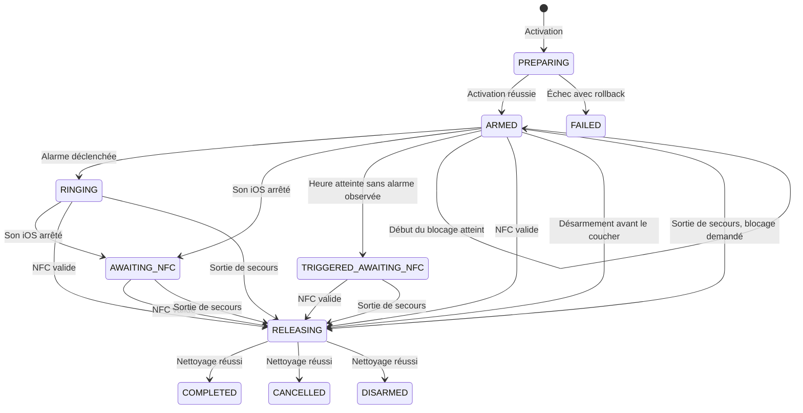

# Niumi Core KMP: spécification métier commune

Statut: contrat proposé pour le MVP Android et iOS
Version du contrat: 1.5 (planning récurrent, désarmement, un à dix Niumi Spots, sortie de secours et temps gagné, 24 octobre 2026, étapes 41 et 42 du plan de refonte ; section 8.4 amendée le 25 octobre 2026 à l'étape 45 : réveil ponctuel, période de 24 h, `EMPTY_PERIOD`) ; 1.4 (boîtiers multiples, 13 octobre 2026) ; 1.3 du 15 septembre 2026 ; 1.2 du 2 septembre 2026
Date de référence: 2 septembre 2026
Plateformes: Android natif et iOS natif
Module partagé: Kotlin Multiplatform

## 1. Objet du document

Cette spécification définit les règles que les applications Android et iOS de Niumi doivent appliquer de la même façon. Elle fixe le modèle de session, les transitions d'état, le calcul du réveil, le protocole NFC, les invariants de blocage et les contrats échangés avec les intégrations natives.

Le module KMP ne remplace pas les deux applications natives. Il fournit leur moteur métier commun.

Les documents de référence sont:

- `docs/OBJECTIF_ET_INTERET_PRODUIT.md` pour l'intention produit;
- les décisions produit fixées dans les spécifications Android et iOS;
- `SPEC_ANDROID.md` pour l'implémentation Android;
- `SPEC_IOS.md` pour l'implémentation iOS;
- le présent document pour tout comportement commun aux deux plateformes.

En cas de contradiction, l'ordre de priorité est le suivant:

1. intention produit, portée par `docs/OBJECTIF_ET_INTERET_PRODUIT.md` et par les décisions produit des spécifications Android et iOS;
2. présent contrat KMP;
3. spécification de la plateforme concernée;
4. code de l'application.

Une limite imposée par Android ou iOS peut justifier une exception native. Cette exception doit être nommée, testée et ajoutée aux trois spécifications. Elle ne doit pas être introduite uniquement dans le code.

## 2. Décisions communes fixées pour le MVP

Les décisions suivantes s'appliquent aux deux applications:

1. Une seule session Niumi peut être active sur un appareil.
2. Une session active fonctionne sans réseau pour le réveil, le blocage, le scan et la fin de session.
3. Une session ne se termine qu'après validation locale de l'un des boîtiers enregistrés au moment du scan (décision 16), ou par la sortie de secours prouvée (décision 13).
4. Avant le coucher, le planning se modifie sans scan : la session en attente est désarmée (`DISARMED`), puis le planning en arme une nouvelle. À partir du coucher et avant le réveil, une modification ou une annulation exige le scan ; le résultat final est alors `CANCELLED`. Contrat 1.5, décision du 2026-10-24 : le coucher est l'instant `blockingStartsAtEpochMillis`, que le blocage ait déjà été demandé ou non (section 5.2).
5. Pendant ou après le réveil, un scan valide mène à `COMPLETED` après nettoyage des sous-systèmes.
6. L'arrêt du son fourni par iOS ne termine pas la session et ne retire pas les blocages.
7. Android ne fournit aucun bouton logiciel d'arrêt dans le parcours Niumi. La sortie de secours (décision 13) n'en est pas un : c'est une libération prouvée par la recopie d'un long texte, qui suit la même phase `RELEASING` qu'un scan (section 12).
8. Le passage à un état final se fait seulement après une phase `RELEASING` réussie.
9. Le réveil conserve l'instant calculé lors de l'activation. Un changement de fuseau ne déplace pas cet instant. *Décision du 2026-10-24 (Q9, contrat 1.5) : avant le coucher, un changement de fuseau fait désarmer la session en attente et réarmer la suivante à l'heure locale du nouveau fuseau, comme toute modification du planning (décision 4) ; après le coucher, l'instant est conservé. Le désarmement et la prochaine occurrence existent dans le moteur ; le coordinateur Android les déclenche depuis l'étape 44 du plan de refonte. Décision du même jour, étape 44 : un changement d'horloge (`TIME_CHANGED`) suit la même règle que le fuseau, et dans les deux cas la session n'est désarmée que si l'un de ses instants recalculés change — une resynchronisation réseau ne désarme rien.*
10. Le même tag NFC physique doit être reconnu par Android et iOS.
11. Les boîtiers s'ajoutent, se renomment et se suppriment à tout moment, session et sonnerie comprises, de un à dix ; la vérification d'un scan porte sur l'ensemble enregistré au moment du scan (décision 16). Contrat 1.5, décision du 2026-10-19 ; le coordinateur Android l'applique depuis l'étape 43 du plan de refonte. La sélection d'applications se modifie avant le coucher comme le reste du planning (décision 4 : désarmement puis nouvelle session) et reste interdite du coucher au scan. *Amendée le 2026-10-24 (étape 44) : elle était interdite « tant qu'une session est active », ce que le planning rend faux — une session `ARMED` existe dès que l'interrupteur est allumé, alors que l'état « Réveil prévu » laisse les applications modifiables (`design-plan/SPECIFICATION.md` §9).*
12. L'utilisateur sélectionne entre 1 et 50 applications.
13. La sortie de secours est le seul secours logiciel : la recopie complète d'un long texte remplace le scan d'un boîtier, le soir comme le matin. Elle est prouvée par `EmergencyExitProof` (section 12). Le moteur l'accepte depuis les mêmes états que le scan, sauf avant le coucher, où le planning se désarme (décision 4). Le matin, la session se termine (`COMPLETED`) ; le soir, elle est annulée (`CANCELLED`). Contrat 1.5 (décision D2 du 2026-10-24), remplace l'ancienne décision qui excluait tout secours logiciel.
14. Un état qui attend le scan sans présentation d'alarme active demande explicitement ce scan à l'utilisateur, sous réserve de l'exception iOS documentée en section 11.2.
15. Le blocage commence à l'activation, ou à un instant de début choisi par l'utilisateur et strictement antérieur au réveil. L'alarme est programmée dès l'activation dans les deux cas. Décision validée le 2026-09-15 (contrat 1.3). Contrat 1.5 : avant le début d'un blocage différé (le coucher), la session peut aussi être désarmée sans scan par un changement de planning (point 4) ; un scan valide l'annule toujours vers `CANCELLED`. À partir du début du blocage, seul le scan la libère.
16. L'utilisateur enregistre de un à dix boîtiers (`PairedBoxLimit`, section 9.2), chacun nommé par lui ; il en reste toujours au moins un. Le scan de n'importe lequel des boîtiers enregistrés au moment du scan termine ou annule la session, y compris un boîtier ajouté après l'activation ; un boîtier supprimé n'arrête plus rien. Décision du 2026-10-19 (contrat 1.5), qui révise celle du 2026-10-13 (contrat 1.4 : un à cinq boîtiers, liste figée à l'activation). Ce que l'on accepte en le décidant : un second boîtier gardé près du lit permet de contourner le réveil — la vérification n'a jamais protégé l'utilisateur contre lui-même, seulement contre un tag étranger (9.2 : un tag NDEF reste clonable). Le moteur vérifie la liste que le coordinateur lui transmet ; la lecture de l'ensemble courant est native (Android : `PairedBoxStore.all()` au moment du scan, depuis l'étape 43 du plan de refonte).

La sortie de secours est le seul secours logiciel, et elle coûte un geste volontaire : recopier en entier un texte de près de deux cents caractères. L'application ne présente ni délai, ni code, ni bouton de déblocage. La politique commune exige au moins un boîtier enregistré (`NO_PAIRED_BOX`) ; les contrôles de préparation natifs, dont le NFC, ne bloquent plus l'activation (section 10, contrat 1.5).

## 3. Périmètre du module partagé

### 3.1 Code placé dans KMP

Le module `:shared:core` contient:

- les états, événements, effets et violations métier;
- le réducteur de session;
- les règles d'activation, d'annulation et de fin;
- le calcul du prochain réveil;
- le calcul de la prochaine occurrence d'un planning récurrent, réveil et coucher (section 8.4, contrat 1.5);
- le calcul de l'instant de début du blocage et sa règle d'antériorité au réveil (section 8.3);
- la politique de changement d'heure et de fuseau;
- le parseur strict du payload NFC;
- la vérification d'un boîtier à partir d'une empreinte locale;
- les limites communes de sélection d'applications;
- les textes de la sortie de secours et la vérification de leur recopie (section 12, contrat 1.5);
- le calcul du temps gagné affiché après le réveil (section 12, contrat 1.5);
- les niveaux de diagnostic et les incidents communs;
- les DTO exposés à Swift;
- les tests métier et les jeux de données de référence.

### 3.2 Code qui reste natif

| Android | iOS |
| --- | --- |
| Jetpack Compose | SwiftUI |
| AlarmManager et PendingIntent | AlarmKit et App Intents |
| Foreground Service, audio, vibration et wake lock | présentation et contrôle sonore AlarmKit |
| AccessibilityService | FamilyControls et ManagedSettings |
| NfcAdapter Reader Mode | Core NFC |
| Room, DataStore et Direct Boot | SwiftData, App Group et Keychain |
| packages Android sélectionnés | jetons opaques Family Controls |
| notifications (sans plein écran depuis le Lot 9 Android, 2026-10-18) | extensions de shield |

Le code commun n'importe aucune API Android ou Apple. Il ne connaît ni `Context`, ni `AlarmManager`, ni `NfcAdapter`, ni `AlarmKit`, ni `ManagedSettingsStore`.

## 4. Invariants produit

Le moteur commun doit refuser toute transition qui enfreint un invariant.

- Une seule session non finale peut exister, y compris pendant `PREPARING`.
- `FAILED` est réservé à une activation qui n'a jamais abouti.
- Une session déjà armée ne passe pas à `FAILED` à cause d'un incident technique.
- Un NFC invalide ne modifie ni l'état, ni le blocage, ni le son.
- Les boîtiers vérifiés pour un scan sont ceux enregistrés au moment du scan (contrat 1.5, décision 16) : le coordinateur natif transmet au vérificateur la liste courante de son dépôt.
- `VALID_NFC_SCANNED` reçu depuis `ARMED` à ou après `triggerAtEpochMillis` est refusé avec la violation `TRIGGER_ALREADY_ELAPSED`. Le coordinateur doit produire `TRIGGER_ELAPSED` avant tout scan dans ce cas, conformément à la section 5.1.
- `releasedBy` est renseigné avant l'entrée dans `RELEASING` ; `nfcVerifiedAt` existe si et seulement si `releasedBy == NFC_SCAN` ; la cible `DISARMED` n'est atteinte que par `releasedBy == PLAN_CHANGE` (contrat 1.5, remplace « `nfcVerifiedAt` doit exister avant l'entrée dans `RELEASING` »).
- `DISARM_REQUESTED` n'est accepté que depuis `ARMED`, blocage en attente, strictement avant `blockingStartsAtEpochMillis` : du coucher au scan, rien ne se désarme.
- `EMERGENCY_EXIT_CONFIRMED` n'est accepté qu'avec une `EmergencyExitProof` liée à l'événement, depuis `ARMED` blocage demandé avant `triggerAtEpochMillis`, `RINGING`, `AWAITING_NFC` ou `TRIGGERED_AWAITING_NFC` ; jamais depuis `ARMED` blocage en attente (contrat 1.5).
- `COMPLETED`, `CANCELLED` et `DISARMED` ne sont atteints qu'après réussite du nettoyage.
- Le blocage reste demandé dans `RINGING`, `AWAITING_NFC` et `TRIGGERED_AWAITING_NFC`, et dans `ARMED` dès que `blockingAppliedAtEpochMillis` est renseigné. Dans `ARMED`, l'état seul ne dit pas si le blocage est demandé : ce champ le dit (section 7.5). Une session ne quitte jamais `ARMED` vers `RINGING`, `AWAITING_NFC` ou `TRIGGERED_AWAITING_NFC` sans que le blocage ait été demandé : le moteur l'applique lui-même dans la transition si le début du blocage n'a pas encore été traité (section 5.1, repli du moteur).
- `blockingStartsAtEpochMillis`, lorsqu'il existe, est strictement antérieur à `triggerAtEpochMillis`, et figé à l'activation au même titre que l'instant du réveil (décision 9).
- `RELEASING` autorise un nettoyage partiel. L'état seul ne permet pas de déduire si le blocage natif est encore appliqué.
- L'arrêt sonore iOS n'est jamais traité comme une preuve NFC.
- `AWAITING_NFC` et `TRIGGERED_AWAITING_NFC` demandent explicitement le scan du boîtier par un signal natif visible. Sur Android, ce signal est une notification persistante quel que soit l'état de l'application. Sur iOS, ce signal se limite au shield actif tant que l'application n'a pas été rouverte après un réveil manqué: c'est une exception assumée à la contrainte Apple sur les notifications locales pour ce cas précis, documentée en section 11.2, et le texte du shield doit alors indiquer explicitement qu'un scan termine la session.
- Aucun événement réseau n'est nécessaire pour autoriser une transition.
- Un événement ancien ou destiné à une autre session ne peut pas faire régresser l'état. Le coordinateur natif déduplique les événements avant d'appeler le moteur.

## 5. Machine à états commune

```kotlin
enum class SessionState {
    PREPARING,
    ARMED,
    RINGING,
    AWAITING_NFC,
    TRIGGERED_AWAITING_NFC,
    RELEASING,
    COMPLETED,
    CANCELLED,
    DISARMED,
    FAILED
}

enum class ReleaseTarget {
    COMPLETED,
    CANCELLED,
    DISARMED
}

enum class ReleaseMeans {
    NFC_SCAN,
    EMERGENCY_EXIT,
    PLAN_CHANGE
}
```

`DISARMED` (contrat 1.5) est l'état final d'une session désarmée sans scan avant son coucher par un changement de planning ; il précède un ré-armement. Il est distinct de `CANCELLED`, qui suit un scan avant le réveil. `ReleaseMeans` dit comment la session a été libérée : `EMERGENCY_EXIT` est renseigné par `EMERGENCY_EXIT_CONFIRMED`, la sortie de secours prouvée par recopie (section 12).



### 5.1 Transitions autorisées

| État source | Événement | État cible | Cible de libération |
| --- | --- | --- | --- |
| aucun | `ACTIVATION_REQUESTED` | `PREPARING` | aucune |
| `PREPARING` | `ACTIVATION_SUCCEEDED` | `ARMED` | aucune |
| `PREPARING` | `ACTIVATION_FAILED` | `FAILED` | aucune |
| `ARMED`, blocage non encore demandé | `BLOCKING_START_ELAPSED` | `ARMED`, `blockingAppliedAtEpochMillis` renseigné | aucune |
| `ARMED` | `ALARM_FIRED` | `RINGING` | aucune |
| `ARMED` ou `RINGING` | `ALARM_SOUND_STOPPED` | `AWAITING_NFC` | aucune |
| `ARMED` | `TRIGGER_ELAPSED` | `TRIGGERED_AWAITING_NFC` | aucune |
| `TRIGGERED_AWAITING_NFC` | `ALARM_SOUND_STOPPED` | état inchangé | aucune |
| `ARMED`, avant `triggerAtEpochMillis` | `VALID_NFC_SCANNED` | `RELEASING` | `CANCELLED` |
| `RINGING`, `AWAITING_NFC` ou `TRIGGERED_AWAITING_NFC` | `VALID_NFC_SCANNED` | `RELEASING` | `COMPLETED` |
| `ARMED`, blocage en attente, avant `blockingStartsAtEpochMillis` | `DISARM_REQUESTED` | `RELEASING`, `releasedBy = PLAN_CHANGE` | `DISARMED` |
| `ARMED`, blocage demandé, avant `triggerAtEpochMillis` | `EMERGENCY_EXIT_CONFIRMED` (preuve) | `RELEASING`, `releasedBy = EMERGENCY_EXIT` | `CANCELLED` |
| `RINGING`, `AWAITING_NFC` ou `TRIGGERED_AWAITING_NFC` | `EMERGENCY_EXIT_CONFIRMED` (preuve) | `RELEASING`, `releasedBy = EMERGENCY_EXIT` | `COMPLETED` |
| `RELEASING` | `RELEASE_FAILED` | `RELEASING` | inchangée |
| `RELEASING` | `RELEASE_SUCCEEDED` | cible enregistrée | inchangée |
| état actif | `INCIDENT_REPORTED` | état inchangé | inchangée |
| état actif | `INVALID_NFC_SCANNED` | état inchangé | inchangée |

`TRIGGER_ELAPSED` est produit seulement si l'heure contractuelle est passée alors que la session est encore `ARMED` et qu'aucune alarme en état `.alerting` n'a été observée. Le coordinateur doit le traiter avant un scan NFC afin qu'un scan après le réveil ne mène jamais à `CANCELLED`. Android joint l'incident `MISSED_TRIGGER_WINDOW` lorsque le retard excède 15 minutes.

`BLOCKING_START_ELAPSED` est produit par le coordinateur natif dès que `blockingStartsAtEpochMillis` est atteint alors que la session est `ARMED` et que le blocage n'a pas encore été demandé. Il ne change pas l'état : il renseigne `blockingAppliedAtEpochMillis` et produit `APPLY_BLOCKING`. Une session à blocage immédiat ne le reçoit jamais, son blocage étant demandé dès `ACTIVATION_REQUESTED`. Android joint l'incident `MISSED_BLOCKING_START_WINDOW` lorsque le retard excède 15 minutes (section 8.3).

**Repli du moteur.** `ALARM_FIRED`, `ALARM_SOUND_STOPPED` et `TRIGGER_ELAPSED` reçus depuis `ARMED` alors que le blocage n'a pas encore été demandé renseignent eux-mêmes `blockingAppliedAtEpochMillis` et ajoutent `APPLY_BLOCKING` à leurs effets, avant la sonnerie ou la demande de scan. Le coordinateur natif doit produire `BLOCKING_START_ELAPSED` à l'heure ; ce repli garantit l'invariant de la section 4 si l'alarme de début a été manquée, sans jamais rendre le réveil muet par un refus.

`DISARM_REQUESTED` (contrat 1.5) est produit par le coordinateur natif quand le planning change avant le coucher. Il ne porte aucune charge. Le blocage n'ayant pas encore été demandé, ses effets se limitent à publier, annuler l'alarme et annuler le début du blocage ; `RELEASE_SUCCEEDED` mène ensuite à `DISARMED` et renseigne `disarmedAtEpochMillis`. La décision commune 8 tient : l'état final n'est atteint qu'après la phase `RELEASING`.

`EMERGENCY_EXIT_CONFIRMED` (contrat 1.5) est produit par le coordinateur natif quand la recopie du texte de secours est complète ; il porte une `EmergencyExitProof` (section 6). Ses effets sont ceux de `VALID_NFC_SCANNED`, et `nfcVerifiedAtEpochMillis` reste nul. Comme pour un scan, le coordinateur produit d'abord `TRIGGER_ELAPSED` si l'heure contractuelle est passée sans alarme observée : le matin, la session se termine (`COMPLETED`) ; le soir, elle est annulée (`CANCELLED`), décision D2 du 2026-10-24.

`ALARM_SOUND_STOPPED` existe pour la contrainte iOS. Android ne doit pas produire cet événement dans le parcours normal. La transition depuis `ARMED` couvre le cas où iOS fournit l'événement d'arrêt avant que l'application ait observé `ALARM_FIRED`; celle depuis `TRIGGERED_AWAITING_NFC` absorbe un fait d'arrêt reçu tardivement sans régression.

### 5.2 Événements refusés

Les cas suivants produisent une `DomainViolation` sans effet natif:

- `RELEASE_SUCCEEDED` hors de `RELEASING`;
- `VALID_NFC_SCANNED` dans `PREPARING`, `COMPLETED`, `CANCELLED` ou `FAILED`;
- `VALID_NFC_SCANNED` depuis `ARMED` à ou après `triggerAtEpochMillis`, avec la violation `TRIGGER_ALREADY_ELAPSED`;
- `ALARM_FIRED` dans un état final;
- `TRIGGER_ELAPSED` avant `triggerAtEpochMillis`;
- `BLOCKING_START_ELAPSED` hors de `ARMED`;
- `BLOCKING_START_ELAPSED` avant `blockingStartsAtEpochMillis`, avec la violation `BLOCKING_START_NOT_REACHED`;
- `BLOCKING_START_ELAPSED` alors que `blockingAppliedAtEpochMillis` est déjà renseigné, ou pour une session à blocage immédiat, avec la violation `BLOCKING_ALREADY_APPLIED`;
- `DISARM_REQUESTED` hors de `ARMED`, avec la violation `INVALID_STATE_TRANSITION`;
- `DISARM_REQUESTED` pour une session dont le blocage est déjà demandé (blocage immédiat ou début déjà traité), avec la violation `BLOCKING_ALREADY_APPLIED`;
- `DISARM_REQUESTED` à ou après `blockingStartsAtEpochMillis`, même si `BLOCKING_START_ELAPSED` n'a pas encore été traité, avec la violation `BLOCKING_START_ALREADY_ELAPSED` (décision du 2026-10-24 : du coucher au scan, tout est verrouillé ; l'instant de début étant strictement antérieur au réveil, ce refus couvre aussi toute demande après le réveil);
- `EMERGENCY_EXIT_CONFIRMED` sans preuve, avec la violation `MISSING_EMERGENCY_PROOF` ; avec une preuve qui ne correspond pas à l'événement, avec `UNEXPECTED_EVENT_PAYLOAD`;
- `EMERGENCY_EXIT_CONFIRMED` depuis `ARMED` blocage en attente (avant le coucher, le planning se désarme), depuis `PREPARING`, `RELEASING` ou un état final, avec la violation `INVALID_STATE_TRANSITION`;
- `EMERGENCY_EXIT_CONFIRMED` depuis `ARMED` à ou après `triggerAtEpochMillis`, avec la violation `TRIGGER_ALREADY_ELAPSED`, comme le scan;
- `ACTIVATION_REQUESTED` dont le `blockingSchedule` est incohérent (champs partiellement renseignés) ou dont `startsAtEpochMillis` n'est pas strictement antérieur à `triggerAtEpochMillis`, avec la violation `INVALID_BLOCKING_SCHEDULE`;
- événement dont le `sessionId` ne correspond pas à la session active;
- horodatage ou identifiant mal formé;
- tentative de régression d'une révision de snapshot.

Le moteur ne conserve pas de registre d'événements. Le coordinateur natif rejette ou reconnaît un doublon avant d'appeler `reduce()`.

## 6. Événements, décisions et effets

Le coeur commun fonctionne comme un réducteur pur:

```kotlin
class SessionEngine {
    fun reduce(
        snapshot: SessionSnapshot?,
        event: SessionEvent
    ): SessionDecision
}
```

```kotlin
data class SessionDecision(
    val snapshot: SessionSnapshot?,
    val effects: List<SessionEffect>,
    val violations: List<DomainViolation>
)
```

Chaque événement possède un identifiant exploité par le registre idempotent du coordinateur:

```kotlin
enum class SessionEventKind {
    ACTIVATION_REQUESTED,
    ACTIVATION_SUCCEEDED,
    ACTIVATION_FAILED,
    ALARM_FIRED,
    ALARM_SOUND_STOPPED,
    TRIGGER_ELAPSED,
    BLOCKING_START_ELAPSED,
    VALID_NFC_SCANNED,
    INVALID_NFC_SCANNED,
    RELEASE_SUCCEEDED,
    RELEASE_FAILED,
    INCIDENT_REPORTED,
    DISARM_REQUESTED,
    EMERGENCY_EXIT_CONFIRMED
}

data class SessionEvent(
    val eventId: String,
    val sessionId: String,
    val kind: SessionEventKind,
    val occurredAtEpochMillis: Long,
    val expectedRevision: Long?,
    val activationRequest: ActivationRequest?,
    val nfcProof: NfcVerificationProof?,
    val failureCode: String?,
    val incident: SessionIncident?,
    val emergencyProof: EmergencyExitProof? = null
)

class NfcVerificationProof internal constructor(
    val boxId: String,
    val sessionId: String,
    val eventId: String,
    val expectedRevision: Long,
    val verifiedAtEpochMillis: Long
)

data class NfcVerificationContext(
    val sessionId: String,
    val eventId: String,
    val expectedRevision: Long,
    val occurredAtEpochMillis: Long
)

class EmergencyExitProof internal constructor(
    val textId: String,
    val sessionId: String,
    val eventId: String,
    val expectedRevision: Long,
    val verifiedAtEpochMillis: Long
)

data class ActivationRequest(
    val wakeSchedule: WakeSchedule,
    val appSelection: AppSelectionSummary,
    val blockingSchedule: BlockingSchedule
)
```

`expectedRevision` est obligatoire sauf pour `ACTIVATION_REQUESTED`. `activationRequest` est obligatoire uniquement pour `ACTIVATION_REQUESTED`. `nfcProof` est obligatoire uniquement pour `VALID_NFC_SCANNED`; le moteur refuse une preuve absente, mal formée, qui ne provient pas de `verifyBox()`, dont `sessionId`, `eventId`, `expectedRevision` ou `verifiedAtEpochMillis` ne correspondent pas à l'événement. `emergencyProof` (contrat 1.5) est obligatoire uniquement pour `EMERGENCY_EXIT_CONFIRMED`, avec les mêmes contrôles que `nfcProof` (violation `MISSING_EMERGENCY_PROOF` si elle manque). `failureCode` est obligatoire uniquement pour `ACTIVATION_FAILED`. `incident` est obligatoire pour `RELEASE_FAILED` et `INCIDENT_REPORTED`; il est facultatif pour `TRIGGER_ELAPSED`, afin d'y joindre `MISSED_TRIGGER_WINDOW`, et pour `BLOCKING_START_ELAPSED`, afin d'y joindre `MISSED_BLOCKING_START_WINDOW`. Les autres événements doivent laisser ces champs à `null`.

`NfcVerificationProof` est une valeur opaque créée uniquement par `NiumiCoreFacade.verifyBox()` après comparaison du payload NFC à la liste de boîtiers transmise par le coordinateur (l'ensemble enregistré au moment du scan, contrat 1.5) ; elle porte le `boxId` du boîtier reconnu. Le coordinateur fournit à cette vérification le `sessionId`, le nouvel `eventId`, la `expectedRevision` et l'horodatage qui sera placé dans l'événement. La preuve est ainsi liée à une seule transition. Elle est transmise en mémoire à `reduce()`, n'est ni sérialisable, ni journalisée, ni placée dans le reçu d'événement. Les adaptateurs natifs ne peuvent pas construire ou réutiliser cette preuve pour un autre événement.

`EmergencyExitProof` (contrat 1.5) suit les mêmes règles. Elle est créée uniquement par `NiumiCoreFacade.verifyEmergencyTranscription()` sur une recopie complète, avec le même contexte que le scan (`NfcVerificationContext`), et porte l'identifiant du texte recopié. Elle n'est ni sérialisée, ni journalisée, ni placée dans le reçu d'événement.

Les effets décrivent ce que le coordinateur natif doit exécuter. Ils ne contiennent aucun appel système.

```kotlin
enum class SessionEffectKind {
    PUBLISH_PLATFORM_SNAPSHOT,
    SCHEDULE_ALARM,
    CANCEL_ALARM,
    APPLY_BLOCKING,
    REMOVE_BLOCKING,
    SCHEDULE_BLOCKING_START,
    CANCEL_BLOCKING_START,
    START_RINGING,
    STOP_RINGING,
    PRESENT_SCAN_REQUEST,
    CLEAR_SCAN_REQUEST,
    CLEAR_ACTIVE_SESSION,
    RECORD_INCIDENT
}

data class SessionEffect(
    val effectId: String,
    val kind: SessionEffectKind,
    val sessionId: String,
    val revision: Long,
    val payload: SessionEffectPayload?
)

sealed interface SessionEffectPayload

data class IncidentEffectPayload(
    val incident: SessionIncident
) : SessionEffectPayload
```

`effectId` est déterministe et dérivé de `sessionId`, de la nouvelle `revision`, du `kind` et de son ordinal dans la décision. `payload` contient les seules données nécessaires à la reprise de l'effet, notamment `IncidentEffectPayload` pour `RECORD_INCIDENT`; il est `null` pour les effets entièrement reconstructibles depuis le snapshot. Avant toute exécution, le coordinateur persiste atomiquement le snapshot, le reçu de l'événement et les effets, avec leur payload, dans une outbox. Il exécute les effets selon leurs dépendances, puis renvoie l'événement de succès ou d'échec au moteur. Une erreur partielle ne permet pas au code natif de choisir directement un autre état.

| Événement appliqué | Effets ordonnés |
| --- | --- |
| `ACTIVATION_REQUESTED` | publier, programmer l'alarme, puis appliquer le blocage (blocage immédiat, ou instant de début déjà dépassé) ou programmer le début du blocage (blocage différé) |
| `ACTIVATION_SUCCEEDED` | publier |
| `ACTIVATION_FAILED` | annuler l'alarme, annuler le début du blocage (blocage différé seulement), retirer le blocage de la transaction, publier, effacer le pointeur actif |
| `BLOCKING_START_ELAPSED` | publier, appliquer le blocage, puis enregistrer l'incident s'il existe |
| `ALARM_FIRED` | publier, appliquer le blocage s'il n'a pas encore été demandé, démarrer la sonnerie native |
| `ALARM_SOUND_STOPPED` ou `TRIGGER_ELAPSED` | publier, appliquer le blocage s'il n'a pas encore été demandé, présenter la demande de scan, puis enregistrer l'incident s'il existe |
| `VALID_NFC_SCANNED` | publier `RELEASING`, annuler l'alarme, annuler le début du blocage (blocage différé seulement), arrêter la sonnerie, retirer la demande de scan, retirer le blocage |
| `DISARM_REQUESTED` | publier `RELEASING`, annuler l'alarme, annuler le début du blocage |
| `EMERGENCY_EXIT_CONFIRMED` | les effets de `VALID_NFC_SCANNED`, dans le même ordre |
| `RELEASE_FAILED` | enregistrer l'incident, publier |
| `RELEASE_SUCCEEDED` | publier l'état final, effacer le pointeur actif |
| `INCIDENT_REPORTED` | enregistrer l'incident, publier |

`CANCEL_BLOCKING_START` : produit uniquement lorsque le `blockingSchedule` de la session est
différé. Une alarme de début n'existe que si `SCHEDULE_BLOCKING_START` l'a demandée, et une session
à blocage immédiat n'en a jamais : l'effet serait alors une annulation sans objet, qu'aucun
coordinateur natif n'a de raison d'exécuter. Précision apportée à l'étape 22 de l'implémentation
Android, la table d'origine ne distinguant pas les deux cas ; décision validée avec l'utilisateur le
2026-09-16, voir `ETAPE-22.md`. Les effets d'une session à blocage immédiat restent ainsi
exactement ceux du contrat 1.2, ordinaux et `effectId` compris.

`INCIDENT_REPORTED` : ligne ajoutée à l'étape 7 de l'implémentation Android. Cette table ne
couvrait pas l'événement d'incident autonome à l'origine. Le même ordre que `RELEASE_FAILED` est
retenu, plutôt que `publier` seul : sans `RECORD_INCIDENT`, la cause de la dégradation ne serait
pas rejouable depuis l'outbox après interruption (exigé par la section 17) et un incident
`CRITICAL` n'aurait rien à présenter dans le diagnostic visible imposé par la section 7.3. Décision
validée avec l'utilisateur le 2026-09-08, voir `ETAPE-07.md`.

Tous les effets sont idempotents. La réconciliation peut les rejouer après avoir comparé l'état métier et l'état natif observé. `ACTIVATION_SUCCEEDED` et `RELEASE_SUCCEEDED` ne sont produits qu'après la réussite de tous les effets requis de leur phase.

Un effet est *requis* pour une phase s'il conditionne l'envoi de l'événement `_SUCCEEDED` correspondant: `SCHEDULE_ALARM` et, selon le `blockingSchedule`, celui des deux effets `APPLY_BLOCKING` ou `SCHEDULE_BLOCKING_START` que la décision a produit, pour `ACTIVATION_SUCCEEDED`; `CANCEL_ALARM`, `STOP_RINGING` et `REMOVE_BLOCKING` pour `RELEASE_SUCCEEDED`, parmi ceux que la décision d'entrée dans `RELEASING` a produits (le désarmement ne produit que `CANCEL_ALARM`, seul effet requis de sa phase). `PUBLISH_PLATFORM_SNAPSHOT`, `PRESENT_SCAN_REQUEST`, `CLEAR_SCAN_REQUEST`, `CANCEL_BLOCKING_START` et `RECORD_INCIDENT` sont toujours best-effort (un début de blocage laissé programmé après un état final est absorbé par le coordinateur, qui refuse tout déclenchement sans session `ARMED` en attente): leur échec est consigné mais ne bloque jamais la phase. Un effet requis dont la précondition a disparu, par exemple `REMOVE_BLOCKING` alors que l'autorisation système a déjà été révoquée par l'utilisateur, est considéré satisfait dès que le coordinateur constate que l'état natif cible est déjà atteint; il enregistre alors un incident `CRITICAL` au lieu de bloquer indéfiniment la phase.

### 6.1 Registre d'événements et outbox native

Le coordinateur natif est responsable de l'idempotence. Pour chaque événement, il stocke dans la même transaction que la décision:

- un reçu avec `eventId`, `sessionId`, l'empreinte canonique du payload et la révision appliquée;
- le nouveau snapshot canonique;
- les effets de la décision, identifiés par `effectId`.

Un événement déjà reçu avec la même empreinte est reconnu sans nouvel appel à `reduce()` ni nouvel effet. La même clé avec une empreinte différente produit `EVENT_ID_CONFLICT`. Les reçus sont conservés avec l'historique de session. Les effets interrompus sont remis en attente et rejoués au redémarrage, au déverrouillage Android ou lors de la réconciliation iOS.

## 7. Modèle commun

### 7.1 Session

```kotlin
data class SessionSnapshot(
    val schemaVersion: Int,
    val revision: Long,
    val sessionId: String,
    val wakeSchedule: WakeSchedule,
    val blockingSchedule: BlockingSchedule,
    val state: SessionState,
    val releaseTarget: ReleaseTarget?,
    val health: SessionHealth,
    val createdAtEpochMillis: Long,
    val armedAtEpochMillis: Long?,
    val blockingAppliedAtEpochMillis: Long?,
    val ringingAtEpochMillis: Long?,
    val alarmSoundStoppedAtEpochMillis: Long?,
    val triggerElapsedAtEpochMillis: Long?,
    val nfcVerifiedAtEpochMillis: Long?,
    val releasingAtEpochMillis: Long?,
    val completedAtEpochMillis: Long?,
    val cancelledAtEpochMillis: Long?,
    val failureCode: String?,
    val releasedBy: ReleaseMeans? = null,
    val disarmedAtEpochMillis: Long? = null
)
```

`schemaVersion` vaut `3` depuis le contrat 1.5 (`2` depuis le contrat 1.3, `1` pour le MVP d'origine). Un snapshot de version 1 se lit comme un blocage immédiat dont `blockingAppliedAtEpochMillis` vaut `createdAtEpochMillis` ; la montée est testée sur chaque plateforme (section 13). `releasedBy` et `disarmedAtEpochMillis` (contrat 1.5) sont ajoutés en fin de snapshot. Un snapshot sans `releasedBy` se lit comme libéré par scan s'il porte `nfcVerifiedAtEpochMillis`, sinon `releasedBy` reste nul : avant le contrat 1.5, seul un scan libérait une session. Cette lecture, faite par la façade, ne dépend pas de `schemaVersion`, afin qu'une persistance native qui ne porte pas encore le champ (Android jusqu'à sa migration Room v6) ne bloque jamais une session en `RELEASING`. `disarmedAtEpochMillis` est renseigné par `RELEASE_SUCCEEDED` vers `DISARMED`, comme `completedAtEpochMillis` et `cancelledAtEpochMillis` pour leur état final. `revision` augmente à chaque décision persistée. Les dates exposées aux plateformes utilisent des millisecondes Unix. Les types `Instant`, `LocalDate` et `LocalTime` peuvent rester internes au module.

### 7.2 Programmation du réveil

```kotlin
data class WakeSchedule(
    val localDateIso: String,
    val localTimeIso: String,
    val zoneIdAtActivation: String,
    val triggerAtEpochMillis: Long
)
```

Les trois premiers champs conservent l'intention saisie. `triggerAtEpochMillis` est l'instant contractuel utilisé par les deux systèmes.

### 7.3 Santé et incidents

```kotlin
enum class SessionHealth {
    HEALTHY,
    DEGRADED
}

enum class ReadinessSeverity {
    BLOCKING_FOR_ALARM,
    BLOCKING_FOR_NIUMI_EXPERIENCE,
    WARNING
}

enum class IncidentSeverity {
    WARNING,
    DEGRADED,
    CRITICAL
}

enum class Platform {
    ANDROID,
    IOS
}

data class SessionIncident(
    val code: String,
    val severity: IncidentSeverity,
    val occurredAtEpochMillis: Long,
    val platform: Platform
)
```

Les violations utilisent au minimum les codes suivants:

```text
UNKNOWN_SESSION
INVALID_STATE_TRANSITION
INVALID_IDENTIFIER
INVALID_TIMESTAMP
STALE_REVISION
EVENT_ID_CONFLICT
MISSING_ACTIVATION_REQUEST
MISSING_FAILURE_CODE
MISSING_INCIDENT
MISSING_NFC_PROOF
UNEXPECTED_EVENT_PAYLOAD
TRIGGER_NOT_REACHED
TRIGGER_ALREADY_ELAPSED
INVALID_APP_SELECTION
INVALID_BLOCKING_SCHEDULE
BLOCKING_START_NOT_REACHED
BLOCKING_ALREADY_APPLIED
BLOCKING_START_ALREADY_ELAPSED
MISSING_EMERGENCY_PROOF
```

`INVALID_BLOCKING_SCHEDULE`, `BLOCKING_START_NOT_REACHED` et `BLOCKING_ALREADY_APPLIED` : ajoutés au contrat 1.3 (blocage différé, section 5.2). `BLOCKING_START_ALREADY_ELAPSED` : ajouté au contrat 1.5, pour un désarmement demandé à ou après le coucher (section 5.2). `MISSING_EMERGENCY_PROOF` : ajouté au contrat 1.5, pour une sortie de secours sans preuve (section 5.2).

`INVALID_APP_SELECTION` : ajouté à l'étape 7 de l'implémentation Android. La section 7.4 refuse une
activation dont `count` est hors de 1..50, mais aucun des treize codes d'origine ne couvrait ce
refus ; `UNEXPECTED_EVENT_PAYLOAD` aurait alors porté deux causes distinctes (charge hors de son
événement, et sélection hors bornes), rendant le diagnostic natif ambigu. Décision validée avec
l'utilisateur le 2026-09-08, voir `ETAPE-07.md`.

Les codes communs initiaux sont, avec leur gravité par défaut:

| Code | Gravité par défaut |
| --- | --- |
| `ALARM_PERMISSION_REVOKED` | `CRITICAL` |
| `BLOCKING_PERMISSION_REVOKED` | `CRITICAL` |
| `NFC_DISABLED` | `CRITICAL` |
| `TIME_CHANGED` | `WARNING` |
| `TIMEZONE_CHANGED` | `WARNING` |
| `MISSED_TRIGGER_WINDOW` | `DEGRADED` |
| `MISSED_BLOCKING_START_WINDOW` | `WARNING` |
| `PROCESS_RECREATED` | `WARNING` |
| `RELEASE_PARTIAL_FAILURE` | `DEGRADED` |
| `SNAPSHOT_CORRUPTED` | `CRITICAL` |

Chaque plateforme peut ajouter des codes préfixés par `ANDROID_` ou `IOS_`, avec leur propre gravité par défaut documentée dans leur spécification. Le module commun ne contient pas les textes affichés à l'utilisateur. Seule exception, assumée (contrat 1.5) : les textes à recopier de la sortie de secours, éléments de protocole contre lesquels la recopie est vérifiée (section 12).

`MISSED_BLOCKING_START_WINDOW` (contrat 1.3) est un `WARNING` et non un `DEGRADED`, contrairement à `MISSED_TRIGGER_WINDOW` : le blocage finit par s'appliquer et le réveil n'est pas touché. Il reste consigné et affiché, parce qu'une session qui annonçait « blocage à 22:30 » et l'a appliqué à 23:10 ne doit pas prétendre le contraire.

Un incident de gravité `WARNING` ne modifie pas `health`. Un incident `DEGRADED` ou `CRITICAL` fait passer `health` à `DEGRADED`; une session active ne revient pas automatiquement à `HEALTHY`. `CRITICAL` se distingue de `DEGRADED` par son traitement natif: il doit en plus être présenté explicitement dans un diagnostic visible par l'utilisateur, alors qu'un `DEGRADED` peut rester consigné sans interrompre le parcours.

### 7.4 Sélection d'applications

Le coeur ne stocke pas les identifiants des applications. Il reçoit uniquement:

```kotlin
data class AppSelectionSummary(
    val count: Int
)
```

Une activation est refusée si `count` est inférieur à 1 ou supérieur à 50. Android conserve ses noms de packages. iOS conserve ses jetons opaques Family Controls.

### 7.5 Début du blocage

```kotlin
data class BlockingSchedule(
    val localDateIso: String?,
    val localTimeIso: String?,
    val startsAtEpochMillis: Long?
)
```

Les trois champs sont tous nuls (blocage immédiat, valeur par défaut) ou tous renseignés (blocage différé) ; tout autre mélange est refusé par `INVALID_BLOCKING_SCHEDULE`. Le fuseau est celui de `WakeSchedule.zoneIdAtActivation` : une session n'a qu'un fuseau d'activation. `startsAtEpochMillis` est l'instant contractuel du début du blocage, calculé selon la section 8.3 ; `blockingAppliedAtEpochMillis` (section 7.1) est l'instant où le moteur a demandé le blocage — l'activation pour un blocage immédiat, la première décision à ou après `startsAtEpochMillis` sinon. Le module commun ne connaît pas la raison d'un blocage différé et n'impose aucune durée minimale entre le début du blocage et le réveil : seule l'antériorité stricte est exigée.

## 8. Politique commune de date et d'heure

### 8.1 Calcul initial

À partir d'une heure locale choisie:

1. utiliser la date, l'heure et le fuseau IANA courants;
2. si le résultat n'est pas strictement futur, choisir le jour civil suivant;
3. si l'heure n'existe pas lors d'un passage à l'heure d'été, prendre le premier instant valide après le saut;
4. si l'heure existe deux fois lors d'un passage à l'heure d'hiver, prendre la première occurrence;
5. enregistrer l'intention locale et l'instant obtenu;
6. afficher la date complète avant confirmation.

L'interface affiche toujours l'heure de l'**instant obtenu**, jamais l'intention locale enregistrée. Les deux ne coïncident pas au point 3 : une saisie de 02:30 la nuit du passage à l'heure d'été désigne une heure qui n'existe pas ce jour-là, et l'alarme sonnera à 03:00. Afficher la saisie serait un faux état de fiabilité, interdit par SPEC_ANDROID §15. L'intention locale reste enregistrée, mais uniquement pour expliquer l'écart : dans ce seul cas, l'écran de confirmation énonce que le changement d'heure fait sauter l'horloge et nomme les deux heures, sans quoi l'écart passerait pour un défaut de l'application.

### 8.2 Après activation

`triggerAtEpochMillis` devient immuable après `ACTIVATION_SUCCEEDED`. La fenêtre de grâce de 15 minutes ci-dessous est une politique de reprogrammation Android, calculée et testée dans le module commun mais sans équivalent iOS: iOS produit `TRIGGER_ELAPSED` dès l'heure atteinte, sans délai de grâce, faute d'API de reprogrammation sonore équivalente à `setAlarmClock()`.

- Un changement de fuseau ne recalcule pas le réveil depuis l'heure locale d'origine.
- Un changement manuel de l'heure ou du fuseau demande aux adaptateurs natifs de préserver le même instant et de réparer leur programmation seulement si leur API l'exige.
- L'interface peut recalculer l'heure d'affichage dans le fuseau courant, sans modifier le contrat.
- Android déclenche immédiatement l'alarme si l'instant est dépassé de 15 minutes ou moins lors d'une réconciliation sans scan NFC en cours. Si un scan valide est déjà en cours et qu'aucune alarme n'est observée, le coordinateur produit d'abord `TRIGGER_ELAPSED` afin de choisir `COMPLETED` sans démarrer une sonnerie transitoire.
- Sur iOS, le coordinateur lit `try AlarmManager.shared.alarms`, dont l'accès peut échouer. Seul l'état `.alerting` produit `ALARM_FIRED`. Une alarme `.scheduled` observée avant `triggerAtEpochMillis` conserve `ARMED`. À l'heure ou après, une lecture réussie sans alarme `.alerting`, y compris une liste ne contenant plus l'alarme ponctuelle, produit `TRIGGER_ELAPSED`. Une erreur de lecture produit l'incident `IOS_ALARM_STATE_READ_FAILED` de gravité `DEGRADED`; elle n'est jamais assimilée à une liste vide. À l'heure ou après, le coordinateur produit tout de même `TRIGGER_ELAPSED` d'après l'horloge avant le scan. Avant l'heure, le scan valide conserve le parcours d'annulation vers `CANCELLED`; les effets de libération annulent l'alarme de façon idempotente.
- Au-delà de 15 minutes sur Android, l'application produit `TRIGGER_ELAPSED` avec `MISSED_TRIGGER_WINDOW`, passe à `TRIGGERED_AWAITING_NFC`, dégrade sa santé, conserve le blocage, présente la demande de scan et attend le scan du boîtier.

La fonction de calcul reçoit explicitement `nowEpochMillis` et le fuseau. Aucun test ne dépend de l'horloge réelle.

### 8.3 Début du blocage

Le début d'un blocage différé est calculé à partir d'une heure locale choisie, avec les règles de la section 8.1 : même fuseau IANA et même `nowEpochMillis` que le réveil, jour civil suivant si l'instant obtenu n'est pas strictement futur, mêmes règles de changement d'heure. L'instant obtenu doit être strictement antérieur à `triggerAtEpochMillis` ; sinon le calcul renvoie `NOT_BEFORE_TRIGGER` et la politique commune refuse l'activation par `BLOCKING_START_NOT_BEFORE_TRIGGER`. La règle de « prochaine occurrence » fait donc refuser, à 20:00 pour un réveil à 07:00, un début à 08:00 (demain, après le réveil) comme un début à 19:00 (demain 19:00, après le réveil) : l'utilisateur doit alors choisir un blocage immédiat. L'interface affiche l'instant obtenu, jamais l'intention saisie, comme pour le réveil (section 8.1).

Après `ACTIVATION_SUCCEEDED`, `startsAtEpochMillis` est immuable : un changement d'heure ou de fuseau ne le déplace pas, et les adaptateurs natifs réparent leur programmation au même instant si leur API l'exige. Si l'instant est dépassé lors d'une réconciliation alors que le blocage n'a pas encore été demandé, le coordinateur produit `BLOCKING_START_ELAPSED` immédiatement, quel que soit le retard : un blocage ne se « manque » pas, il s'applique en retard. Android y joint `MISSED_BLOCKING_START_WINDOW` (`WARNING`) au-delà de 15 minutes, en réutilisant `evaluateTriggerDelay` ; iOS n'a pas cette fenêtre. Un instant de début déjà dépassé au moment de `ACTIVATION_REQUESTED` est traité comme un blocage immédiat par le moteur, qui produit alors `APPLY_BLOCKING` au lieu de `SCHEDULE_BLOCKING_START`.

### 8.4 Prochaine occurrence d'un planning

Contrat 1.5. Un planning récurrent porte les jours de réveil cochés (numérotation ISO, 1 = lundi … 7 = dimanche), une heure de réveil et une heure de coucher. Le calcul est commun ; l'interrupteur général et le stockage du planning restent natifs. *Amendé le 2026-10-25 (décisions de Mehdi, étape 45 du plan de refonte) : un ensemble de jours vide est un réveil ponctuel, deux heures identiques forment une période de 24 h ; `NO_DAY_ENABLED` et `BEDTIME_EQUALS_WAKE` sont retirés, `EMPTY_PERIOD` les remplace pour le seul trou de printemps.*

```kotlin
data class WakePlan(val enabledIsoDays: Set<Int>, val wakeTimeIso: String, val bedtimeIso: String) // jours vides = ponctuel
data class NextOccurrenceInput(val plan: WakePlan, val zoneId: String, val nowEpochMillis: Long)
enum class NextOccurrenceStatus { VALID, INVALID_TIME, UNKNOWN_ZONE, EMPTY_PERIOD }
data class NextOccurrence(val wakeSchedule: WakeSchedule, val blockingSchedule: BlockingSchedule, val blockingStartsImmediately: Boolean)
data class NextOccurrenceResult(val status: NextOccurrenceStatus, val occurrence: NextOccurrence?)
```

Règles :

1. fuseau inconnu → `UNKNOWN_ZONE` ; heure de réveil ou de coucher illisible → `INVALID_TIME`. Deux heures identiques ne sont pas un refus : elles forment une période de 24 h (règle 4). *Jusqu'au 2026-10-25, elles répondaient `BEDTIME_EQUALS_WAKE`, l'interface imposant 15 minutes d'écart (Q8 du 2026-10-24) ; Q8 révisé : une minute d'écart au sélecteur, 5 min au cadran, égalité acceptée* ;
2. les valeurs hors de 1..7 sont ignorées ; un ensemble vide, ou sans aucun jour valide, vaut **tous les jours** : c'est le réveil ponctuel (`design-plan/SPECIFICATION.md` §2, D17 tranché le 2026-10-25). *Jusqu'au 2026-10-25, ce cas répondait `NO_DAY_ENABLED`* ;
3. pour chaque jour civil d'aujourd'hui à dans sept jours, dans le fuseau reçu, dont le jour ISO est coché (n'importe lequel pour un réveil ponctuel), l'heure de réveil est résolue selon la section 8.1 (points 3 et 4) ; la première occurrence strictement future est retenue, jamais un réveil déjà passé aujourd'hui. Un réveil ponctuel sonne donc aujourd'hui si l'heure est encore à venir, sinon le lendemain ;
4. le coucher a lieu la veille du réveil si son heure est plus tardive que celle du réveil **ou lui est égale** (période de 24 h, depuis le 2026-10-25), sinon le jour même (`design-plan/SPECIFICATION.md` §2), avec les mêmes règles de changement d'heure. Pour un réveil ponctuel, une période de 24 h est toujours déjà en cours (règle 6) : le blocage est immédiat ;
5. si le changement d'heure ramène le coucher à un instant égal ou postérieur au réveil alors que leurs heures locales diffèrent (trou de printemps), → `EMPTY_PERIOD` plutôt qu'un planning que l'activation refuserait (`INVALID_BLOCKING_SCHEDULE`). *Ce statut s'appelait `BEDTIME_EQUALS_WAKE` jusqu'au 2026-10-25* ;
6. si le coucher est déjà atteint, la période est en cours : `blockingStartsImmediately = true` et `blockingSchedule` vaut le blocage immédiat ; sinon `blockingSchedule` porte la date, l'heure et l'instant du coucher ;
7. `wakeSchedule.localTimeIso` est l'intention saisie et `zoneIdAtActivation` le fuseau reçu.

Le résultat se convertit directement en `ActivationRequest`. `blockingStartsImmediately` sert aussi aux plateformes à demander confirmation avant d'armer une occurrence dont la période est déjà en cours ; le moteur, lui, n'en demande aucune (Android depuis le 2026-10-25, `design-plan/SPECIFICATION.md` §2). Une fois la session armée, ses instants sont immuables (section 8.2) ; un changement de planning ou de fuseau avant le coucher passe par le désarmement puis une nouvelle occurrence (décisions 4 et 9).

**Fin d'un réveil ponctuel (native, décision de Mehdi du 2026-10-25).** Le moteur ne connaît pas l'interrupteur : c'est la plateforme qui l'éteint quand une session se termine en `COMPLETED` (scan ou recopie du matin) alors que le planning n'a aucun jour coché, au lieu d'armer l'occurrence suivante. Une session `DISARMED` ne consomme pas le réveil ponctuel : il est réarmé. Android l'applique depuis l'étape 45 (`DefaultWakePlanScheduler`, SPEC_ANDROID §9.2) ; l'iPhone doit appliquer la même règle (SPEC_IOS §15).

## 9. Protocole NFC commun

### 9.1 Payload canonique

Le tag contient un seul enregistrement NDEF URI reconnu:

```text
niumi://box/v1/{boxId}?token={token}
```

Exemple de forme, avec valeurs non utilisables en production:

```text
niumi://box/v1/550e8400-e29b-41d4-a716-446655440000?token=AAAAAAAAAAAAAAAAAAAAAA
```

Contraintes:

- schéma ASCII minuscule `niumi`;
- hôte ASCII minuscule `box`;
- chemin composé de `v1` puis d'un UUID canonique minuscule;
- `boxId` au format `8-4-4-4-12`;
- query composée uniquement d'un paramètre `token`, présent une fois;
- token de 16 octets aléatoires, encodé en Base64 URL sans padding, soit 22 caractères;
- aucun utilisateur, mot de passe, port ou fragment;
- aucun encodage par pourcentage;
- aucun octet nul ou caractère de contrôle;
- longueur maximale de 96 octets UTF-8;
- aucun segment ou paramètre supplémentaire.

Le parseur ne doit pas accepter une URI qu'une normalisation permissive rendrait équivalente.

### 9.2 Stockage et comparaison

```kotlin
data class PairedBoxCredential(
    val protocolVersion: Int,
    val boxId: String,
    val tokenSha256Hex: String
)
```

L'application stocke, pour chaque boîtier associé, le `boxId` canonique et l'empreinte SHA-256 des 16 octets décodés. Elle compare les empreintes en temps constant. Elle ne journalise jamais le token, sa forme encodée ou son empreinte complète.

**Plusieurs boîtiers (contrat 1.4, révisé par 1.5, décision 16).** L'application conserve une liste ordonnée de un à dix credentials — `PairedBoxLimit.MIN = 1`, `PairedBoxLimit.MAX = 10` (cinq au contrat 1.4), constante commune au même titre que les bornes 1–50 de la sélection d'applications — chacun accompagné d'un nom choisi par l'utilisateur, donnée de plateforme hors du module commun. Un `boxId` déjà présent n'est pas ajouté une seconde fois. La vérification d'un scan compare le payload à chaque credential de la liste transmise par le coordinateur, c'est-à-dire l'ensemble enregistré au moment du scan (contrat 1.5) :

```kotlin
object BoxVerifier {
    fun verify(
        payload: BoxPayload,
        credentials: List<PairedBoxCredential>,
        context: NfcVerificationContext?
    ): BoxVerificationResult
}

enum class BoxVerificationStatus { MATCH, NO_PAIRED_BOX_MATCH, UNSUPPORTED_VERSION }
```

`UNSUPPORTED_VERSION` si la version du payload n'est pas prise en charge; sinon `MATCH` au premier credential dont le `boxId` est égal **et** dont l'empreinte correspond, la preuve portant ce `boxId`; sinon `NO_PAIRED_BOX_MATCH`, liste vide comprise. Les anciens `BOX_MISMATCH` et `TOKEN_MISMATCH` disparaissent : distinguer « bon identifiant, mauvais token » n'avait de sens que face à un boîtier unique, et c'est une information de moins qui sort du module. Une empreinte non canonique dans la liste est un credential qui ne correspond pas, jamais une exception.

Le token statique ne rend pas le tag inviolable. Un tag NDEF reste clonable. Une protection anti-clonage demandera un nouveau protocole et un tag capable de produire une preuve cryptographique dynamique.

### 9.3 Résultats du parseur

Le parseur retourne un résultat typé parmi:

```text
VALID
UNSUPPORTED_SCHEME
UNSUPPORTED_HOST
UNSUPPORTED_VERSION
INVALID_BOX_ID
MISSING_TOKEN
INVALID_TOKEN
UNEXPECTED_COMPONENT
PAYLOAD_TOO_LONG
MALFORMED_URI
```

Android et iOS utilisent directement ce parseur. Les lecteurs NFC natifs ne décident jamais eux-mêmes qu'un payload est valide.

## 10. Activation commune

Le coordinateur natif applique cette transaction:

1. exécuter les contrôles natifs et les règles communes;
2. envoyer `ACTIVATION_REQUESTED`;
3. persister atomiquement l'état `PREPARING`, le reçu de l'événement et l'outbox, puis publier le snapshot natif;
4. programmer l'alarme native;
5. appliquer le blocage natif si le blocage est immédiat, ou programmer le début du blocage natif s'il est différé;
6. vérifier les résultats observables sans prétendre prouver ce que l'OS ne permet pas de lire;
7. envoyer `ACTIVATION_SUCCEEDED`;
8. persister `ARMED`, republier le snapshot et confirmer à l'écran.

Contrat 1.5 : les contrôles de préparation natifs ne bloquent plus l'activation (`design-plan/SPECIFICATION.md` §2, « l'interrupteur s'active toujours ») ; les manques sont signalés par la plateforme. La politique commune accepte une liste de contrôles vide et applique alors seulement ses règles communes. Android ne transmet plus ses contrôles depuis l'étape 44 du plan de refonte pour l'armement depuis le planning (`ArmOccurrenceUseCase`) ; seul l'écran transitoire d'activation ponctuelle les transmet encore, jusqu'à son remplacement par l'accueil (étape 45).

Si une étape échoue:

1. annuler l'alarme éventuellement créée;
2. annuler le début du blocage éventuellement programmé;
3. retirer uniquement le blocage créé par cette transaction;
4. envoyer `ACTIVATION_FAILED`;
5. persister `FAILED` avec `failureCode`;
6. ne pas conserver de pointeur de session active.

L'engagement n'est pris qu'après `ACTIVATION_SUCCEEDED`. Pour un blocage différé, le blocage lui-même n'est demandé qu'à `BLOCKING_START_ELAPSED`. Contrat 1.5 : jusqu'au coucher, un changement de planning désarme la session sans scan (`DISARM_REQUESTED`, décision 4) ; à partir du coucher, le scan est la seule sortie.

À l'étape 1, le coordinateur natif compte les `PairedBoxCredential` du dépôt : une liste vide refuse l'activation (`NO_PAIRED_BOX`), plus de dix boîtiers aussi (`TOO_MANY_PAIRED_BOXES`, section 14). Contrat 1.5 (décision 16) : la liste n'est plus figée dans la session ; chaque vérification lit l'ensemble enregistré au moment du scan, et le parcours d'association reste ouvert pendant la session. Le sélecteur d'applications reste désactivé du coucher au scan (décision 11, amendée le 2026-10-24) ; avant le coucher, un changement de sélection désarme la session en attente et en arme une nouvelle.

## 11. Déclenchement, arrêt sonore et scan

### 11.1 Android

`AlarmReceiver` produit `ALARM_FIRED`. Le coordinateur applique la décision du coeur, démarre le service de sonnerie et conserve le blocage. Avant un scan depuis `ARMED`, il sérialise la réconciliation de l'heure et de l'état natif: si l'heure est passée sans alarme observée, il produit d'abord `TRIGGER_ELAPSED`.

`PRESENT_SCAN_REQUEST` se traduit sur Android par une notification persistante distincte de celle de la sonnerie: aucun son, aucune vibration, aucun full-screen intent. Elle informe que le scan est attendu sans simuler une alarme active. Ce comportement s'applique aussi lorsque `TRIGGER_ELAPSED` est produit avant le premier déverrouillage, depuis le coordinateur Direct Boot.

### 11.2 iOS

Le coordinateur lit `try AlarmManager.shared.alarms` avant un scan depuis `ARMED`. Seul l'état `.alerting` produit `ALARM_FIRED`; une alarme `.scheduled` avant l'heure conserve `ARMED`. À l'heure ou après, une lecture réussie sans alarme `.alerting` produit `TRIGGER_ELAPSED`. Si la lecture échoue, il enregistre `IOS_ALARM_STATE_READ_FAILED` avec la gravité `DEGRADED`; à l'heure ou après, il produit néanmoins `TRIGGER_ELAPSED` d'après l'horloge avant le scan. Avant l'heure, il conserve le parcours d'annulation. `NiumiStopIntent` publie un fait natif immuable, ensuite converti en `ALARM_SOUND_STOPPED` par l'application principale. Cet événement ne retire aucun shield.

`PRESENT_SCAN_REQUEST` se traduit sur iOS par un routage immédiat vers l'écran de réveil dès que le coordinateur observe le fait, sans notification locale: iOS n'observe ce fait qu'application active (lancement, retour au premier plan ou avant un scan). Tant que l'application n'a pas été rouverte, seuls les shields signalent que la session reste active. C'est l'exception native documentée en section 4: le shield doit alors afficher un texte actionnable qui indique explicitement qu'un scan du boîtier termine la session, afin de rester une porte de sortie utilisable plutôt qu'un simple constat.

Le scan Core NFC produit `VALID_NFC_SCANNED` seulement après passage par le parseur et le vérificateur communs, avec la `NfcVerificationProof` opaque retournée par ce dernier.

### 11.3 Début du blocage différé

Android : une alarme exacte distincte du réveil, ciblant `BlockingStartReceiver`, produit `BLOCKING_START_ELAPSED` (`SPEC_ANDROID.md`, section 12.4). Le coordinateur applique la décision et exécute `APPLY_BLOCKING` sur la projection lue par le service d'accessibilité. Toute réconciliation qui trouve une session `ARMED` dont l'instant de début est atteint sans blocage demandé produit le même événement.

iOS : le mécanisme natif pressenti est une planification `DeviceActivitySchedule` observée par une extension `DeviceActivityMonitor`, qui applique les shields à `intervalDidStart` et publie un fait natif immuable, ensuite converti en `BLOCKING_START_ELAPSED` par l'application principale — même patron que `alarmStopped`. Ce mécanisme est `À REVOIR · POC` (`SPEC_IOS.md`, section 1.2). L'invariant de la section 4 tient dans tous les cas grâce au repli du moteur (section 5.1).

## 12. Libération atomique

À la réception d'un scan valide, ou d'une sortie de secours prouvée (contrat 1.5), le moteur:

1. renseigne `releasedBy` (`NFC_SCAN` ou `EMERGENCY_EXIT`) et, pour un scan seulement, `nfcVerifiedAtEpochMillis`;
2. passe à `RELEASING`;
3. choisit `CANCELLED` si l'état source était `ARMED` avant l'heure contractuelle;
4. choisit `COMPLETED` si l'état source était `RINGING`, `AWAITING_NFC` ou `TRIGGERED_AWAITING_NFC`;
5. produit les effets de nettoyage.

Le coordinateur natif exécute ensuite:

1. persistance atomique de `RELEASING`, du reçu et de l'outbox;
2. publication du snapshot natif;
3. annulation ou arrêt de l'alarme;
4. arrêt du son, de la vibration et des ressources de réveil lorsqu'ils existent;
5. retrait du blocage Niumi;
6. vérification des résultats observables;
7. envoi de `RELEASE_SUCCEEDED` seulement après la réussite des effets requis;
8. persistance de l'état final et suppression du pointeur de session active.

Une interruption conserve `RELEASING`. La réconciliation reprend uniquement les effets manquants et ne réapplique pas un blocage déjà retiré. Une erreur de nettoyage produit `RELEASE_PARTIAL_FAILURE`, conserve les effets incomplets dans l'outbox et ne transforme pas la session en état final.

Le désarmement (contrat 1.5) suit la même phase sans scan : `DISARM_REQUESTED` renseigne `releasedBy = PLAN_CHANGE`, passe à `RELEASING` avec la cible `DISARMED`, puis le coordinateur annule l'alarme et le début du blocage et envoie `RELEASE_SUCCEEDED` dès que l'annulation de l'alarme a réussi. Aucun blocage n'est à retirer : il était encore en attente.

**Sortie de secours (contrat 1.5).** `EmergencyExitTexts` porte les textes à recopier. Un seul est validé (`"v1-01"`, 190 caractères avec ses apostrophes typographiques ; revu le 2026-10-24 sans changer d'identifiant, « arrêter mon réveil » remplaçant « sortir de cette session », 196 caractères auparavant) : la liste est prête à en recevoir d'autres, mais tant qu'il est seul, le texte ne change pas d'une sortie à l'autre (D8, décision du 2026-10-24). `EmergencyTranscription.verify(textId, typed, context)` compare la saisie au texte :

- la saisie et le modèle sont normalisés : minuscules, lettres accentuées du français repliées (`œ` en `oe`, `æ` en `ae`), tout ce qui n'est ni lettre, ni chiffre, ni espace retiré, puis découpage sur les espaces. « J’avais », « J'avais » et « Javais » se valent, comme la majuscule automatique du clavier. `commonMain` n'offre pas de normalisation Unicode (NFD) : les accents sont repliés par une table, et les diacritiques combinants disparaissent avec la ponctuation;
- la comparaison se fait mot à mot. Tous les mots égaux et en même nombre : `COMPLETE`. Une saisie plus courte, dont seul le dernier mot peut être le début du mot attendu : `INCOMPLETE`, saisie vide comprise. Un mot différent, ou un mot de trop : `MISMATCH`, avec `mismatchWordIndex` égal à l'index du premier mot qui diffère (le nombre de mots du modèle pour un mot de trop). Un identifiant inconnu : `UNKNOWN_TEXT`;
- `typedCharCount` est la longueur brute de la saisie, pour le compteur affiché ; `expectedCharCount` celle du texte;
- la preuve n'est produite que sur `COMPLETE` avec un contexte, comme `verifyBox`.

Le coordinateur vérifie la saisie sans contexte pendant la frappe, puis avec le contexte de l'événement `EMERGENCY_EXIT_CONFIRMED` qu'il s'apprête à produire.

**Temps gagné (contrat 1.5).** `TimeToGetUpCalculator` reçoit l'instant de la sonnerie, celui de la libération et la durée déclarée à l'écran 3 bis. Le temps écoulé est arrondi à la minute inférieure, et une libération antérieure à la sonnerie compte pour zéro (Q10). Les minutes gagnées valent la durée déclarée moins le temps écoulé, seulement si le résultat est strictement positif, sinon `null`. « 1 heure et + » compte pour 60 minutes (D3) ; la plateforme transmet cette valeur. Les deux décisions datent du 2026-10-24.

Si un effet requis ne peut plus jamais réussir parce que sa précondition a disparu, par exemple un blocage déjà retiré par le système après révocation d'une autorisation, le coordinateur applique la règle d'échappement de la section 6 plutôt que de bloquer indéfiniment `RELEASING`.

## 13. Snapshots et persistance

Le coeur définit les champs communs et leur sens. Les formats physiques restent natifs.

### Android

Room reste la source persistante canonique après déverrouillage et doit permettre un aller-retour complet avec `SessionSnapshot`. Le snapshot Direct Boot est une projection partielle de la persistance Android, mais son enveloppe de session active contient tous les champs de `SessionSnapshot` requis par `reduce()`, avec les données Android nécessaires au démarrage de l'alarme. Il contient aussi le registre et l'outbox nécessaires avant déverrouillage, ensuite réconciliés avec Room.

### iOS

SwiftData reste la source persistante canonique de l'application et doit permettre un aller-retour complet avec `SessionSnapshot`. Le snapshot App Group est une projection partielle contenant l'identifiant AlarmKit et les données minimales lues par les extensions. Les App Intents écrivent des événements immuables et ne réduisent pas directement la machine à états.

### Règles partagées

- écriture atomique;
- une décision acceptée augmente l'unique `revision` métier;
- `revision` et `domainRevision` utilisent le même type sur les deux plateformes: un entier signé 64 bits, non négatif et strictement croissant (`Long` en Kotlin, `Int64` en Swift); aucune projection native ne les représente en `UInt64`;
- les projections utilisent `projectionSchemaVersion`, `domainSchemaVersion` et `domainRevision`;
- une projection peut être réécrite à `domainRevision` égale, mais jamais avec une révision inférieure;
- migration testée avant toute montée de version;
- un snapshot de `schemaVersion` 1 se lit comme un blocage immédiat déjà demandé (`blockingAppliedAtEpochMillis = createdAtEpochMillis`) ; la montée à 2 est testée sur les deux plateformes;
- un snapshot sans `releasedBy` se lit comme libéré par scan s'il porte `nfcVerifiedAtEpochMillis` (section 7.1) ; la montée à 3 est testée sur les deux plateformes (Android : migration Room v6 et projection Direct Boot v5, étape 43 du plan de refonte);
- corruption traitée explicitement;
- aucune suppression silencieuse du blocage à cause d'un snapshot illisible;
- aucune donnée NFC secrète ou sélection d'applications iOS dans les logs.

Les plateformes doivent avoir un test de mapping aller-retour entre leur modèle canonique et `SessionSnapshot`, ainsi que des tests distincts pour leurs projections partielles. Android vérifie en plus que son snapshot Direct Boot actif peut être converti en `SessionSnapshot` avant le premier déverrouillage.

## 14. API exposée aux applications

L'API publique du framework reste petite et simple à appeler depuis Swift:

```kotlin
class NiumiCoreFacade {
    fun reduce(
        snapshot: SessionSnapshotDto?,
        event: SessionEventDto
    ): SessionDecisionDto

    fun computeWakeSchedule(
        input: WakeScheduleInputDto
    ): WakeScheduleResultDto

    fun parseBoxPayload(
        uri: String
    ): BoxPayloadResultDto

    fun verifyBox(
        payload: BoxPayloadDto,
        credentials: List<PairedBoxCredentialDto>,
        context: NfcVerificationContextDto?
    ): BoxVerificationResultDto

    fun evaluateActivation(
        input: ActivationPolicyInputDto
    ): ActivationPolicyResultDto

    fun evaluateTriggerDelay(
        input: TriggerDelayInputDto
    ): TriggerDelayResultDto

    fun computeBlockingSchedule(
        input: BlockingScheduleInputDto
    ): BlockingScheduleResultDto

    fun computeNextOccurrence(
        input: NextOccurrenceInputDto
    ): NextOccurrenceResultDto

    fun emergencyExitTexts(): List<EmergencyExitTextDto>

    fun verifyEmergencyTranscription(
        input: EmergencyTranscriptionInputDto,
        context: NfcVerificationContextDto?
    ): EmergencyTranscriptionResultDto

    fun computeTimeToGetUp(
        input: TimeToGetUpInputDto
    ): TimeToGetUpResultDto
}
```

`emergencyExitTexts`, `verifyEmergencyTranscription` et `computeTimeToGetUp` : neuvième à onzième méthodes, ajoutées par le contrat 1.5 (section 12). Elles ne changent pas le schéma 3 : aucun champ persisté n'est ajouté, et `emergencyProof` n'est jamais sérialisé.

`computeNextOccurrence` : huitième méthode, ajoutée par le contrat 1.5 (section 8.4). Elle rend réveil et coucher prêts pour une activation, ou le statut qui empêche d'armer.

`computeBlockingSchedule` : septième méthode, ajoutée par le contrat 1.3 (section 8.3). Un `localTimeIso` nul décrit un blocage immédiat et renvoie `VALID` avec un `BlockingScheduleDto` aux trois champs nuls ; sinon l'instant est résolu comme un réveil puis comparé à `triggerAtEpochMillis`.

La version du schéma des DTO exposés par la façade, portée par `NiumiCoreVersion.SCHEMA_VERSION`,
passe de `1` à `2` avec le contrat 1.3, puis à `3` avec le contrat 1.5 (`DISARMED`,
`DISARM_REQUESTED`, `ReleaseMeans`, deux champs de snapshot, huitième méthode) : les valeurs par
défaut Kotlin des nouveaux champs ne traversent pas la frontière Swift, la rupture est donc réelle
pour iOS. Elle est distincte de
`SessionSnapshot.schemaVersion` (§7.1), qui décrit le snapshot persisté.

`evaluateTriggerDelay` : sixième méthode, ajoutée à l'étape 8 de l'implémentation Android. Elle
expose la fenêtre de grâce Android de 15 minutes du §8.2 (politique de reprogrammation calculée et
testée dans le module commun, sans équivalent iOS faute d'API de reprogrammation sonore équivalente
à `setAlarmClock()`). iOS peut l'ignorer.

Types cités par la présente section mais non détaillés ailleurs dans ce contrat (décision
d'implémentation, étape 8) :

```kotlin
data class WakeScheduleInputDto(
    val localTimeIso: String,
    val zoneId: String,
    val nowEpochMillis: Long
)

enum class WakeScheduleStatusDto { VALID, INVALID_TIME, UNKNOWN_ZONE }

data class WakeScheduleResultDto(
    val status: WakeScheduleStatusDto,
    val schedule: WakeScheduleDto?
)

data class TriggerDelayInputDto(
    val triggerAtEpochMillis: Long,
    val nowEpochMillis: Long
)

enum class TriggerDelayOutcomeDto { NOT_REACHED, FIRE_NOW, MISSED }

data class TriggerDelayResultDto(
    val outcome: TriggerDelayOutcomeDto
)

data class ReadinessCheckInputDto(
    val id: String,
    val severity: ReadinessSeverity,
    val passed: Boolean
)

data class ActivationPolicyInputDto(
    val checks: List<ReadinessCheckInputDto>,
    val appSelectionCount: Int,
    val triggerAtEpochMillis: Long,
    val nowEpochMillis: Long,
    val pairedBoxCount: Int,
    val blockingStartsAtEpochMillis: Long?
)

data class BlockingScheduleInputDto(
    val localTimeIso: String?,
    val zoneId: String,
    val nowEpochMillis: Long,
    val triggerAtEpochMillis: Long
)

enum class BlockingScheduleStatusDto { VALID, INVALID_TIME, UNKNOWN_ZONE, NOT_BEFORE_TRIGGER }

data class BlockingScheduleDto(
    val localDateIso: String?,
    val localTimeIso: String?,
    val startsAtEpochMillis: Long?
)

data class BlockingScheduleResultDto(
    val status: BlockingScheduleStatusDto,
    val schedule: BlockingScheduleDto?
)

data class ActivationReasonDto(
    val code: String,
    val checkId: String?
)

data class ActivationPolicyResultDto(
    val allowed: Boolean,
    val blockingReasons: List<ActivationReasonDto>,
    val warnings: List<ActivationReasonDto>
)

// Contrat 1.5 (section 8.4)
data class WakePlanDto(val enabledIsoDays: Set<Int>, val wakeTimeIso: String, val bedtimeIso: String)
data class NextOccurrenceInputDto(val plan: WakePlanDto, val zoneId: String, val nowEpochMillis: Long)
enum class NextOccurrenceStatusDto { VALID, INVALID_TIME, UNKNOWN_ZONE, EMPTY_PERIOD } // alias de NextOccurrenceStatus ; amendé le 2026-10-25 (section 8.4)
data class NextOccurrenceDto(val wakeSchedule: WakeScheduleDto, val blockingSchedule: BlockingScheduleDto, val blockingStartsImmediately: Boolean)
data class NextOccurrenceResultDto(val status: NextOccurrenceStatusDto, val occurrence: NextOccurrenceDto?)

// SessionSnapshotDto (contrat 1.5) : + releasedBy: ReleaseMeansDto? = null, + disarmedAtEpochMillis: Long? = null
// SessionEventDto (contrat 1.5) : + emergencyProof: EmergencyExitProof? = null (jamais sérialisé)

// Contrat 1.5 (section 12)
data class EmergencyExitTextDto(val id: String, val text: String, val charCount: Int)
data class EmergencyTranscriptionInputDto(val textId: String, val typed: String)
enum class TranscriptionStatusDto { COMPLETE, INCOMPLETE, MISMATCH, UNKNOWN_TEXT }
data class EmergencyTranscriptionResultDto(val status: TranscriptionStatusDto, val matchedWordCount: Int, val mismatchWordIndex: Int?,
                                           val expectedCharCount: Int, val typedCharCount: Int, val proof: EmergencyExitProof?)
data class TimeToGetUpInputDto(val alarmAtEpochMillis: Long, val releasedAtEpochMillis: Long, val declaredMinutes: Int)
data class TimeToGetUpResultDto(val elapsedMinutes: Int, val savedMinutes: Int?)
```

`ActivationReasonDto.code` ne porte jamais de texte affiché à l'utilisateur (§7.3) : uniquement un
code stable, éventuellement accompagné de `checkId` pour retrouver le contrôle de préparation natif
en cause. `blockingStartsAtEpochMillis` (contrat 1.3) est `null` pour un blocage immédiat ; renseigné
et non strictement antérieur à `triggerAtEpochMillis`, il produit la raison bloquante
`BLOCKING_START_NOT_BEFORE_TRIGGER`, sans `checkId`, comme `TRIGGER_NOT_IN_FUTURE`. `WakeScheduleResultDto.schedule` et `TriggerDelayResultDto` suivent la même convention que
`BoxPayloadResultDto`/`BoxVerificationResultDto` (§9.3) plutôt qu'un type scellé `Success`/`Failure` :
uniformité du module et confort d'appel depuis Swift, décision validée avec l'utilisateur le
2026-09-08.

Contraintes d'interopérabilité:

- DTO concrets, sans `Result<T>` public;
- pas de type Android ou Apple;
- pas de `Flow` ou fonction `suspend` dans la façade Swift du MVP;
- chaînes canoniques pour les UUID;
- millisecondes Unix à la frontière;
- enums stables pour les états et codes;
- erreurs renvoyées comme valeurs typées, sans exception traversant la frontière Swift;
- moteur pur et déterministe;
- aucune horloge globale cachée.

Les types Kotlin plus expressifs peuvent rester internes si la façade les convertit en DTO simples.

Lorsqu'un appel de scan avec contexte réussit, `BoxVerificationResultDto` expose la `NfcVerificationProof` opaque à transmettre immédiatement dans `SessionEventDto` ; elle porte le `boxId` du credential reconnu dans la liste. Le contexte contient la session, l'événement, la révision attendue et l'horodatage. Une vérification sans session passe `null` et ne reçoit aucune preuve ; l'association elle-même n'appelle plus `verifyBox` (contrat 1.4) : elle parse le payload, en dérive le credential et laisse le dépôt natif refuser un doublon ou un onzième boîtier. Le type ne possède pas d'initialiseur public côté Swift et n'est jamais stocké. `EmergencyTranscriptionResultDto.proof` (contrat 1.5) suit la même règle : à transmettre immédiatement dans `SessionEventDto.emergencyProof`.

`ActivationPolicyInputDto.pairedBoxCount: Int` remplace `hasPairedBox: Boolean` (contrat 1.4). La politique refuse l'activation avec `NO_PAIRED_BOX` sous `PairedBoxLimit.MIN` et avec `TOO_MANY_PAIRED_BOXES` au-dessus de `PairedBoxLimit.MAX` (section 9.2).

## 15. Structure du monorepo

```text
niumi-mobile/
  shared/
    core/
      build.gradle.kts
      src/
        commonMain/kotlin/com/niumi/core/
          domain/
          schedule/
          nfc/
          diagnostics/
          interop/
        commonTest/kotlin/com/niumi/core/
        commonTest/resources/fixtures/

  androidApp/
    app/
    core/
      database/
      system/
      designsystem/
    feature/
      setup/
      session/
      ringing/

  iosApp/
    NiumiApp/
    NiumiShieldConfigurationExtension/
    NiumiShieldActionExtension/
    NiumiTests/

  specs/
    SPEC_CORE_KMP.md
    SPEC_ANDROID.md
    SPEC_IOS.md

  docs/
    OBJECTIF_ET_INTERET_PRODUIT.md
```

Le dépôt ne publie pas le framework commun comme dépendance distante pendant le MVP. Android et iOS consomment le même commit du monorepo.

## 16. Configuration Gradle du module KMP

Ajouter `:shared:core` dans `settings.gradle.kts`. Les versions restent centralisées dans `gradle/libs.versions.toml`, sans version dynamique.

Le module applique:

```kotlin
plugins {
    alias(libs.plugins.kotlin.multiplatform)
    alias(libs.plugins.android.kotlin.multiplatform.library)
    alias(libs.plugins.kotlin.serialization)
}

kotlin {
    android {
        namespace = "com.niumi.core"
        compileSdk = 37
        minSdk = 29
    }

    jvm()
    iosArm64()
    iosSimulatorArm64()

    targets.withType<org.jetbrains.kotlin.gradle.plugin.mpp.KotlinNativeTarget>()
        .configureEach {
            binaries.framework {
                baseName = "NiumiCore"
                isStatic = true
            }
        }

    sourceSets {
        commonMain.dependencies {
            implementation(libs.kotlinx.datetime)
            implementation(libs.kotlinx.serialization.json)
        }

        commonTest.dependencies {
            implementation(kotlin("test"))
        }
    }
}
```

`jvm()` sert aux tests rapides du domaine. Il ne crée pas une troisième application. Ajouter `iosX64()` seulement si un poste ou un runner Intel doit construire le framework.

Le module utilise le plugin Android officiellement prévu pour les bibliothèques KMP. L'application Android reste un module `com.android.application` distinct.


L'application principale importe:

```swift
import NiumiCore
```

Dans le monorepo, utiliser l'intégration directe Xcode. Le module déclare un framework, puis la cible principale ajoute une phase de script avant `Compile Sources`:

```sh
if [ "YES" = "$OVERRIDE_KOTLIN_BUILD_IDE_SUPPORTED" ]; then
  exit 0
fi

cd "$SRCROOT/.."
./gradlew :shared:core:embedAndSignAppleFrameworkForXcode
```

Adapter uniquement le chemin `cd` à l'emplacement réel du projet Xcode. Désactiver `Based on dependency analysis` pour cette phase et désactiver `User Script Sandboxing` pour la cible qui exécute Gradle.

`SessionCoordinator` reste le propriétaire natif de l'orchestration, mais délègue chaque transition à `NiumiCoreFacade`. SwiftData, App Group, AlarmKit, Core NFC et ManagedSettings restent derrière les protocoles Swift existants.

Les extensions iOS ne sont pas obligées d'importer KMP. Elles peuvent lire un DTO Swift versionné qui reflète les champs communs. Un test de contrat doit vérifier ce mapping.

## 17. Tests communs obligatoires

Les tests `commonTest` couvrent au minimum:

### Machine à états

- toutes les transitions autorisées;
- toutes les transitions interdites;
- scan valide depuis `ARMED` avant `triggerAtEpochMillis`, avec cible `CANCELLED`;
- scan refusé depuis `ARMED` à ou après `triggerAtEpochMillis`, avec la violation `TRIGGER_ALREADY_ELAPSED`;
- scan valide depuis `RINGING`, `AWAITING_NFC` ou `TRIGGERED_AWAITING_NFC`, avec cible `COMPLETED`;
- `TRIGGER_ELAPSED` à l'heure prévue, après l'heure et avant l'heure prévue;
- arrêt sonore sans fin de session;
- persistance de `RELEASING` après échec partiel;
- doublons stricts, identifiants réutilisés avec un payload différent et événements d'une autre session;
- preuve NFC absente, invalide ou réutilisée hors de son événement de scan;
- validation de `failureCode` et des charges spécifiques à chaque événement;
- santé inchangée pour `WARNING`, dégradée pour `DEGRADED` et `CRITICAL`;
- impossibilité de passer une session active à `FAILED`;
- révisions métier croissantes et refus des révisions obsolètes;
- `PRESENT_SCAN_REQUEST` produit par `ALARM_SOUND_STOPPED` et par `TRIGGER_ELAPSED`, `CLEAR_SCAN_REQUEST` produit par `VALID_NFC_SCANNED`, tous deux rejouables de façon idempotente en reprise;
- `BLOCKING_START_ELAPSED` depuis `ARMED` avant, à et après `startsAtEpochMillis` ; refusé hors de `ARMED`, refusé une seconde fois (`BLOCKING_ALREADY_APPLIED`), refusé pour un blocage immédiat;
- `ACTIVATION_REQUESTED` produit `APPLY_BLOCKING` pour un blocage immédiat ou dont l'instant de début est déjà dépassé, `SCHEDULE_BLOCKING_START` sinon ; refus d'un `blockingSchedule` incohérent ou non strictement antérieur au réveil (`INVALID_BLOCKING_SCHEDULE`);
- repli du moteur : `ALARM_FIRED`, `ALARM_SOUND_STOPPED` et `TRIGGER_ELAPSED` depuis `ARMED` sans blocage demandé produisent `APPLY_BLOCKING` avant leurs autres effets et renseignent `blockingAppliedAtEpochMillis` ; aucun effet supplémentaire quand le blocage est déjà demandé;
- scan valide depuis `ARMED` avant le début du blocage : cible `CANCELLED`, effets `CANCEL_BLOCKING_START` et `REMOVE_BLOCKING` présents;
- `MISSED_BLOCKING_START_WINDOW` joint à `BLOCKING_START_ELAPSED` ne dégrade pas la santé;
- lecture d'un snapshot de version 1 comme blocage immédiat déjà demandé;
- désarmement (contrat 1.5) : `DISARM_REQUESTED` depuis `ARMED` en attente avant le coucher mène à `RELEASING` vers `DISARMED` avec `releasedBy = PLAN_CHANGE` et les effets publier, annuler l'alarme, annuler le début du blocage ; refusé blocage déjà demandé (`BLOCKING_ALREADY_APPLIED`), à ou après le coucher même début non traité, et après le réveil (`BLOCKING_START_ALREADY_ELAPSED`), hors de `ARMED` (`INVALID_STATE_TRANSITION`) ; `RELEASE_SUCCEEDED` mène à `DISARMED` et renseigne `disarmedAtEpochMillis`;
- `releasedBy = NFC_SCAN` renseigné par `VALID_NFC_SCANNED` ; `RELEASE_SUCCEEDED` refusé sur un `RELEASING` sans `releasedBy`, ou dont `nfcVerifiedAt`, `releasedBy` et la cible se contredisent;
- lecture d'un snapshot sans `releasedBy` : `NFC_SCAN` s'il porte `nfcVerifiedAtEpochMillis`, nul sinon, quelle que soit `schemaVersion`;
- sortie de secours (contrat 1.5) : `EMERGENCY_EXIT_CONFIRMED` depuis `ARMED` blocage demandé avant le réveil mène à `RELEASING` vers `CANCELLED`, depuis `RINGING`, `AWAITING_NFC` et `TRIGGERED_AWAITING_NFC` vers `COMPLETED`, avec `releasedBy = EMERGENCY_EXIT`, sans `nfcVerifiedAt` et avec les effets du scan ; refusée sans preuve (`MISSING_EMERGENCY_PROOF`), avec la preuve d'un autre événement ou portée par un autre événement (`UNEXPECTED_EVENT_PAYLOAD`), depuis `ARMED` en attente ou un état final (`INVALID_STATE_TRANSITION`), depuis `ARMED` à ou après le réveil (`TRIGGER_ALREADY_ELAPSED`) ; `RELEASE_SUCCEEDED` conserve `releasedBy`.

### Date et heure

- heure choisie plus tard le même jour;
- bascule au jour suivant;
- heure inexistante au printemps;
- heure répétée à l'automne;
- changement de fuseau après activation sans changement de l'instant;
- retards de 0, 15 et plus de 15 minutes, avec `TRIGGER_ELAPSED` et `MISSED_TRIGGER_WINDOW` au-delà de 15 minutes; cette fenêtre de grâce est la politique Android, testée ici pour le calcul mais sans équivalent iOS;
- début du blocage : plus tard le même jour, bascule au jour suivant, heure inexistante au printemps, heure répétée à l'automne, instant égal ou postérieur au réveil refusé (`NOT_BEFORE_TRIGGER`), `localTimeIso` nul résolu en blocage immédiat, fuseau inchangé après activation;
- prochaine occurrence (contrat 1.5) : jeudi soir → vendredi matin avec coucher jeudi ; vendredi soir → lundi avec coucher dimanche ; coucher après minuit le jour même du réveil ; période en cours et coucher atteint à la milliseconde → blocage immédiat ; heure de réveil passée un jour coché → jour coché suivant, jusqu'au même jour la semaine suivante ; heure inexistante au printemps et répétée à l'automne ; heure et fuseau invalides. *Amendé le 2026-10-25 (section 8.4)* : aucun jour → réveil ponctuel aujourd'hui si l'heure est à venir, sinon le lendemain, week-end compris ; jours hors bornes seuls → ponctuel ; heures égales → période de 24 h, coucher la veille à la même heure, avec ou sans jour coché, blocage toujours immédiat en ponctuel ; heures distinctes confondues par le trou de printemps → `EMPTY_PERIOD`. Fixtures partagées `shared/core/src/commonTest/resources/fixtures/wake_plans.json` mises à jour le même jour (`no_checked_day_is_a_one_off_alarm_at_the_next_wake_time`, `bedtime_equal_to_wake_is_a_twenty_four_hour_period`, `bedtime_and_wake_merged_by_spring_gap_are_reported_as_an_empty_period`).

### NFC

- payload canonique;
- UUID en majuscules;
- token absent, dupliqué, paddé, trop court ou mal encodé;
- query ou fragment supplémentaire;
- encodage par pourcentage;
- payload supérieur à 96 octets;
- vérification contre une liste de boîtiers (contrat 1.4) : liste vide, un boîtier, cinq boîtiers avec correspondance en première, en dernière et en aucune position, identifiant connu avec mauvais token, empreinte non canonique dans la liste ignorée sans exception, preuve portant le `boxId` reconnu;
- comparaison constante dans l'implémentation dédiée;
- fuzzing avec chaînes vides, caractères de contrôle et UTF-8 invalide à la frontière native.

### Politiques

- sélections de 0, 1, 50 et 51 applications;
- blocage conservé dans `RINGING`, `AWAITING_NFC` et `TRIGGERED_AWAITING_NFC`, et dans `ARMED` dès que `blockingAppliedAtEpochMillis` est renseigné ; non demandé dans `ARMED` tant qu'il est nul;
- activation refusée par `BLOCKING_START_NOT_BEFORE_TRIGGER` quand l'instant de début n'est pas strictement antérieur au réveil, autorisée avec un instant nul;
- nettoyage partiel autorisé dans `RELEASING`, sans finalisation avant la réussite des effets requis;
- reprise de `RECORD_INCIDENT` après interruption avec son code, sa gravité, son horodatage et sa plateforme;
- aucune fin sans `releasedBy` cohérent : `nfcVerifiedAt` pour un scan, `PLAN_CHANGE` pour un désarmement (contrat 1.5, remplace « aucune fin sans `nfcVerifiedAt` »);
- aucun besoin de réseau pour une décision critique;
- vérification effectuée contre la liste de boîtiers transmise par le coordinateur, refusée pour tout credential hors de cette liste;
- 0, 1, 10 et 11 boîtiers enregistrés (`NO_PAIRED_BOX`, accepté, accepté, `TOO_MANY_PAIRED_BOXES`, contrat 1.5);
- liste de contrôles de préparation vide acceptée, règles communes toujours appliquées (contrat 1.5).

### Sortie de secours et temps gagné (contrat 1.5)

- texte validé recopié mot pour mot, 190 caractères, sans « ce soir » ni chiffre ; identifiant inconnu sans texte;
- recopie exacte complète ; majuscules, accents précomposés ou combinants, ponctuation, apostrophe droite ou omise et espaces en double ignorés ; point final omis accepté;
- premier mot divergent signalé à son index ; préfixe toléré pour le dernier mot seulement ; saisie vide incomplète ; mot de trop signalé après le dernier mot;
- preuve produite sur une recopie complète avec contexte, jamais sans contexte, ni sur une saisie incomplète ou fausse, ni pour un texte inconnu;
- temps gagné : 7:00 à 7:04 avec 15 minutes déclarées donne 4 et 11 ; aucun gain si l'on est plus lent ou aussi rapide ; minute inférieure (7:04:59 donne 4) ; libération avant la sonnerie comptée zéro ; 60 minutes déclarées pour « 1 heure et + ».

Des fixtures communes décrivent les entrées et résultats attendus. Les tests natifs utilisent aussi ces fixtures pour valider leurs conversions.

## 18. Tests natifs conservés

Android conserve les tests de `AlarmManager`, PendingIntent, Direct Boot, Foreground Service, audio, AccessibilityService, notifications, Reader Mode, Room et mapping KMP.

iOS conserve les tests AlarmKit, App Intents, ManagedSettings, Family Controls, Core NFC, SwiftData, App Group, extensions et mapping KMP.

Un test commun vert ne remplace jamais une recette sur appareil réel.

## 19. Intégration continue et parité

Chaque Pull Request qui touche une règle métier exécute sur un runner macOS:

1. tests JVM de `:shared:core`;
2. compilation du framework iOS KMP;
3. tests et build Android;
4. tests et build iOS;
5. vérification des fixtures et schémas;
6. analyse statique des deux plateformes.

Une fonctionnalité commune n'est terminée que si:

- le contrat KMP est mis à jour;
- les tests communs passent;
- les deux applications consomment la même API;
- les adaptateurs natifs sont testés;
- la matrice de parité est verte ou contient une exception OS documentée.


| Section iOS | Action | Modification attendue |
| --- | --- | --- |
| 1.2 Points à revoir | Modifier | Retirer le changement d'heure des décisions ouvertes. Adopter la règle commune. Remplacer la décision NFC par le protocole avec token. |
| 2. Résultat attendu | Compléter | Ajouter l'annulation ou la modification avant réveil après scan NFC. Ajouter la limite de 50 comme règle commune. |
| 4.1 Arrêt sonore | Modifier | Remplacer `releasePending` par `RELEASING` dans le vocabulaire métier. Conserver `AWAITING_NFC` après Stop. |
| 4.6 Procédure de secours | Fixer (contrat 1.5) | La sortie de secours par recopie remplace l'absence de secours : textes, vérification de la recopie et preuve viennent de KMP. Ce que fait l'alarme pendant la recopie reste ouvert (`design-plan/SPECIFICATION.md` §13). |
| 4.7 Fabrication NFC | Modifier | Fixer un UUID de boîtier et un token aléatoire de 16 octets. Ajouter le contrôle qualité de ces deux valeurs. |
| 5. Choix techniques | Compléter | Ajouter `NiumiCore` en Kotlin Multiplatform et l'intégration directe Xcode. |
| 7. Architecture du code | Modifier | Remplacer les modèles et le réducteur Swift dupliqués par les DTO et la façade KMP. Garder les protocoles système Swift. |
| 7. Règles d'architecture | Modifier | `SessionCoordinator` reste l'orchestrateur, mais `NiumiCoreFacade` devient l'unique autorité de transition. |
| 8. NiumiSession | Modifier | Ajouter l'intention locale, le fuseau d'activation, `revision`, `health`, `releaseTarget`, `releasingAt` et `cancelledAt`. Fournir un mapping vers `SessionSnapshot`. |
| 8. SessionPhase | Remplacer | Utiliser les neuf états communs, dont `TRIGGERED_AWAITING_NFC`. Ajouter `CANCELLED`. Renommer `releasePending` en `RELEASING`. |
| 8. SharedSessionSnapshot | Modifier | Utiliser `projectionSchemaVersion`, `domainSchemaVersion` et `domainRevision`; conserver `alarmID` dans l'enveloppe iOS. Ajouter un test de contrat entre la projection Swift et KMP. |
| 8. SharedSessionEvent | Conserver avec adaptation | L'intent continue d'écrire `alarmStopped`. L'application principale le convertit en `ALARM_SOUND_STOPPED` pour KMP. |
| 8. Boîtier associé | Remplacer | Accepter la query canonique `token`, fixer 96 octets maximum et stocker `boxId` plus l'empreinte du token dans le Keychain. |
| 9. Machine à états | Remplacer | Utiliser la machine commune. Ajouter `ARMED -> RELEASING -> CANCELLED` pour l'annulation NFC avant réveil. |
| 10. Préflight | Modifier | Mapper les résultats vers les sévérités communes. Les autorisations et actions de réglage restent Swift. |
| 11. Calcul de la date | Fixer | Appliquer la première occurrence lors d'une heure répétée et le premier instant valide après une heure inexistante. Conserver l'instant après activation. |
| 11. Transaction d'activation | Modifier | Faire passer `ACTIVATION_REQUESTED`, `ACTIVATION_SUCCEEDED` et `ACTIVATION_FAILED` par KMP. |
| 12. NiumiStopIntent | Conserver avec adaptation | Ne pas importer le moteur dans l'intent. Conserver l'événement immuable, puis le réduire dans l'application principale. |
| 12. Observation de l'alarme | Compléter | Router immédiatement vers l'écran de réveil dès qu'`ALARM_SOUND_STOPPED` ou `TRIGGER_ELAPSED` est produit. Documenter que ce signal n'existe qu'application active. |
| 14. Association et lecture NFC | Remplacer en partie | Les sessions Core NFC lisent l'URI. Le parseur et la comparaison métier sont exécutés par KMP. |
| 14. Validation du payload | Remplacer | Utiliser exactement la section 9 du présent contrat. La query `token` devient obligatoire. |
| 15. Fin de session | Modifier | Remplacer le passage natif à `releasePending` par `VALID_NFC_SCANNED`, puis exécuter les effets de `RELEASING` et envoyer `RELEASE_SUCCEEDED`. |
| 16. Restauration | Modifier | Réduire les événements via KMP, router vers l'écran de réveil sur `PRESENT_SCAN_REQUEST` et reprendre les effets manquants de `RELEASING`. |
| 17. Session active | Compléter | Ajouter une action de modification ou d'annulation qui ouvre le scan. Aucun changement n'est appliqué avant l'état `CANCELLED`. |
| 22. Tests unitaires | Répartir | Déplacer les règles communes vers `commonTest`. Garder AlarmKit, ManagedSettings, App Group, Core NFC et mappings dans les tests Swift. |
| 23. Critères d'acceptation | Modifier | Ajouter l'annulation NFC, `CANCELLED`, le protocole commun, la règle horaire et l'interdiction de finaliser avant nettoyage. |
| 24. Ordre d'implémentation | Compléter | Ajouter le Lot 0.5 KMP après validation du POC natif. Le Lot 1 remplace ensuite le domaine Swift dupliqué. |
| 26. Définition de terminé | Compléter | Exiger les tests communs, les mappings et la construction du framework KMP dans Xcode. |
| 8. NiumiSessionRecord | Compléter (contrat 1.3) | Ajouter `blockingLocalDateISO`, `blockingLocalTimeISO`, `blockingStartsAt` et `blockingAppliedAt` ; lire une version 1 comme blocage immédiat déjà demandé. |
| 9. Machine à états | Compléter (contrat 1.3) | Ajouter `ARMED -> ARMED` sur `BLOCKING_START_ELAPSED` et le repli du moteur sur `ALARM_FIRED`, `ALARM_SOUND_STOPPED` et `TRIGGER_ELAPSED`. |
| 11. Transaction d'activation | Compléter (contrat 1.3) | Appliquer les shields à l'activation ou programmer leur début ; exiger un instant de début strictement antérieur au réveil. |
| 13. Application des shields | Compléter (contrat 1.3) | Décrire le début différé par `DeviceActivityMonitor`, `À REVOIR · POC`. |
| 16. Restauration | Compléter (contrat 1.3) | Produire `BLOCKING_START_ELAPSED` quand l'instant de début est atteint sans shields appliqués. |
| 17. Session active | Compléter (contrat 1.3) | Afficher l'instant de début du blocage tant qu'il n'est pas atteint. |
| 8. NiumiSessionRecord | Compléter (contrat 1.5) | Ajouter `releasedBy` et `disarmedAt` ; lire un enregistrement sans `releasedBy` comme libéré par scan s'il porte `nfcVerifiedAt`. |
| 9. Machine à états | Compléter (contrat 1.5) | Ajouter `DISARMED`, `ARMED -> RELEASING -> DISARMED` sur `DISARM_REQUESTED` avant le coucher, refusé à partir du coucher. |
| 11. Calcul de la date | Compléter (contrat 1.5) | Calculer la prochaine occurrence d'un planning par `computeNextOccurrence` ; jamais de calcul de jour ou de coucher en Swift. |
| 11. Calcul de la date | Compléter (contrat 1.5 amendé le 2026-10-25) | Aucun jour coché = réveil ponctuel, heures identiques = 24 h ; plus de `NO_DAY_ENABLED` ni de `BEDTIME_EQUALS_WAKE`, `EMPTY_PERIOD` pour le trou de printemps. |
| 15. Fin de session | Compléter (contrat 1.5) | Distinguer `releasedBy` ; désarmement : annuler l'alarme AlarmKit et le début des shields, sans retirer de shield. |
| 15. Fin de session | Compléter (contrat 1.5 amendé le 2026-10-25) | Après `COMPLETED` d'un réveil ponctuel (aucun jour coché), éteindre l'interrupteur au lieu d'armer l'occurrence suivante ; règle native, comme sur Android. |
| 9. Machine à états | Compléter (contrat 1.5) | Ajouter `EMERGENCY_EXIT_CONFIRMED` depuis les états du scan, sauf `ARMED` en attente : `CANCELLED` le soir, `COMPLETED` le matin. |
| 14. Association et lecture NFC | Compléter (contrat 1.5) | Un à dix Niumi Spots, modifiables en session ; vérifier contre l'ensemble enregistré au moment du scan. |
| 15. Fin de session | Compléter (contrat 1.5) | Sortie de secours : vérifier la recopie par `verifyEmergencyTranscription`, puis produire `EMERGENCY_EXIT_CONFIRMED` avec la preuve ; mêmes effets qu'un scan. Temps gagné par `computeTimeToGetUp`. |

## 20. Points qui restent dépendants des POC

Le présent contrat ne prétend pas résoudre les contraintes système suivantes:

- acceptation Google Play de l'usage AccessibilityService;
- entitlement Family Controls et distribution App Store;
- comportement AlarmKit après redémarrage, à l'exception de l'indisponibilité documentée du `secondaryIntent` avant le premier déverrouillage;
- ouverture de Niumi depuis un shield;
- exécution d'une extension `DeviceActivityMonitor` à l'instant planifié et application des shields depuis cette extension (début du blocage différé, contrat 1.3);
- lecture NFC lorsque le téléphone est verrouillé;
- comportement des surcouches Android sur les services et notifications;
- choix industriel du tag, écriture, verrouillage et remplacement du boîtier.

Un échec sur l'un de ces points peut modifier une intégration native. Il ne doit pas affaiblir silencieusement les invariants communs.

## 21. Références d'intégration

- [Plugin Android Gradle pour une bibliothèque KMP](https://developer.android.com/kotlin/multiplatform/plugin)
- [Intégration directe du framework KMP dans Xcode](https://kotlinlang.org/docs/multiplatform/multiplatform-direct-integration.html)
- [Méthodes d'intégration iOS de Kotlin Multiplatform](https://kotlinlang.org/docs/multiplatform/multiplatform-ios-integration-overview.html)
- [kotlinx.datetime `TimeZone`](https://kotlinlang.org/api/kotlinx-datetime/kotlinx-datetime/kotlinx.datetime/-time-zone/)
